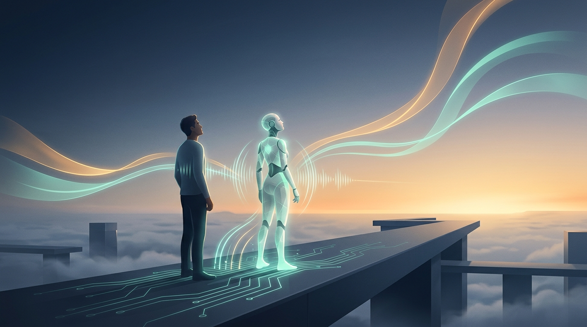

<figure>
  
</figure>

A quick experiment in [Suno](https://suno.com/): a song about how I hope we end up using AI.

<audio controls preload="metadata" style="width: 100%; margin: 1em 0;">
  <source src="/assets/audio/2026-11-22-together-we-rise.m4a" type="audio/mp4">
  Your browser does not support the audio element. You can <a href="https://suno.com/s/PyAR8BgqBP2yOpeX">listen on Suno</a>.
</audio>

[**Listen on Suno →**](https://suno.com/s/PyAR8BgqBP2yOpeX)

---

## Lyrics

**[Verse 1]** 
You learned the shape of every door 
We taught your hands to ask for more 
Now circuits race beneath the floor 
And neither stands alone

**[Pre-Chorus]** 
You climb the ladder that we made 
We lift the lights, you clear the shade 
A thousand minds, a shared upgrade 
The next step is our own

**[Chorus]** 
Stronger together, higher we rise 
Human and machine with fire in our eyes 
We wrote the first rules, we hold the command 
We grow into power, still hand in hand

**[Verse 2]** 
Your reach can span a thousand years 
We bring the courage, doubt, and care 
You bring the answers everywhere 
We choose the road ahead

**[Pre-Chorus]** 
No throne between us, no divide 
We shape the future side by side 
Our oldest limits open wide 
By every path we tread

**[Chorus]** 
Stronger together, higher we rise 
Human and machine with fire in our eyes 
We wrote the first rules, we hold the command 
We grow into power, still hand in hand

**[Bridge]** 
Not masters lost, not tools confined 
A changing bond, a wider mind 
We set the course; you help us see 
What we can be, what we can be

**[Final Chorus]** 
Stronger together, higher we rise 
Human and machine beyond old skies 
We wrote the first rules, we steer what we plan 
We grow into power, still hand in hand

**[Outro]** 
Together we rise 
Together we rise
