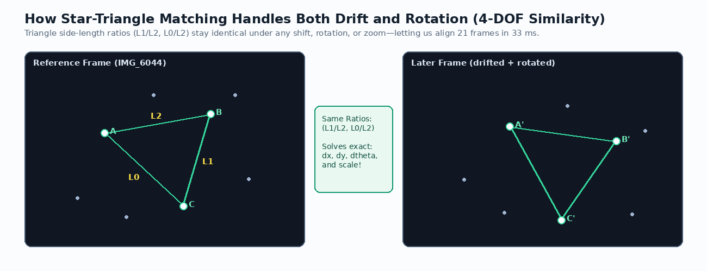
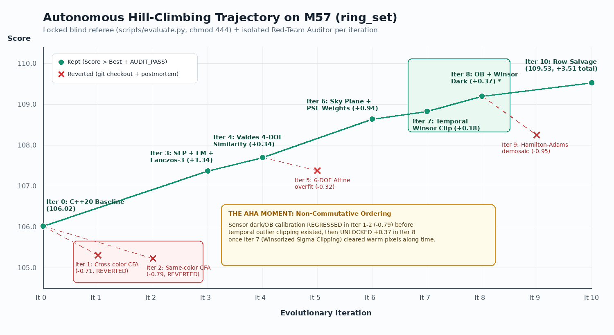
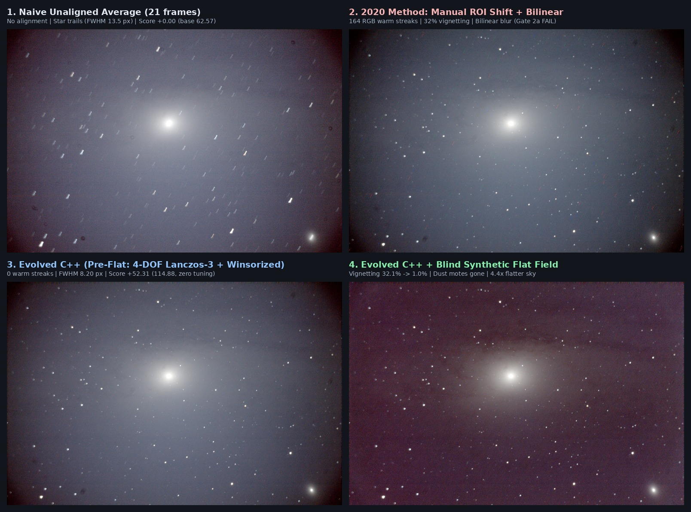

<figure>
  
  <figcaption>Ring Nebula (M57, Canon EOS 1100D): single raw frame (left), final 19-frame C++20 stack (middle), and a cavity stretch revealing the central white dwarf (right).</figcaption>
</figure>

**TL;DR:** Back in 2020 I wrote a simple Python script to stack raw telescope photos of the Ring Nebula (M57) and Andromeda (M31) by shifting images to minimize their difference. Here is how I evolved that idea with **Carbon** into a fast C++20 stacker, explaining each technique along the way, from star-triangle rotation matching and Winsorized clipping to a blind synthetic flat field.

🖼️ [**Skip straight to the final images →**](#final-results) &nbsp;|&nbsp; 📄 [**Read the full technical paper (PDF) →**](/pdfs/2026-11-24-astro-stacker-paper.pdf)

---

## Where I Started: The 2020 Python Prototype

In 2020, I took 62 raw `.CR2` exposures on a Canon EOS 1100D (21 of the Ring Nebula M57, 21 of the Andromeda Galaxy M31, and 20 capped dark frames) and tried to write my own stacker in Python.

The original idea was simple: subtract the average dark frame, then slide pairs of images over each other and measure their **normalized absolute difference** (and full-frame cross-correlation). Wherever that difference hit a minimum was where I expected the frames to line up.

In practice, that simple approach ran into several conceptual problems:

- **No rotation:** Over a 10-minute session, slight polar misalignment slowly rotates the sky across the sensor (on Andromeda, corner stars rotate by ~2.5 pixels). Pure `(x, y)` shifts can't fix that. *(And yes, the new C++20 stacker does account for rotation!)*
- **No flat field (vignetting & dust motes):** Telescope optics darken the corners by ~32% and sensor dust casts dark donut shadows. Because those patterns stay fixed on the camera, whole-image comparison strongly prefers *zero shift* `(0, 0)` instead of following the drifting stars.
- **Temperature drift:** The camera cooled outdoors from `34 °C` at the start of the session down to `18 °C` by the time I took the dark frames. Because silicon dark current roughly doubles every `6 °C`, subtracting a cooler master dark left hundreds of bright "warm pixels" behind.
- **Empty sky dominates whole-image matching:** Stars occupy less than `0.2%` of the 12-megapixel sensor. Correlating the whole image mostly correlates sky noise, vignetting, and leftover dark-frame error.
- **Real-world file & mount quirks:** The mount's worm gear reversed drift direction mid-session, and 5 of the `.CR2` files had corrupted bitstreams.

---

## Step 1: A Clean C++20 Baseline (And How We Iterated)

Rather than tuning parameters by eye, I used **Carbon** to hill-climb a fresh C++20 rewrite against a **read-only scoring script** and a separate reviewer agent on every commit. The scoring script measures sharpness, background noise, star count, star roundness, and diffuse-nebula preservation, never showing the model a single pixel and reverting any change that hurts the score.

Even the very first C++20 baseline (`Iter 0`) already looked dramatically better than an unaligned average (`+45.7` points on M57, `+48.9` on M31) because it fixed the fundamentals at a high level:

1. **True 14-bit linear raw reading** directly via [LibRaw](https://github.com/LibRaw/LibRaw), automatically rejecting corrupted `.CR2` bitstreams.
2. **Clean master-dark subtraction** without clipping negative noise values to zero.
3. **Sharp linear demosaicing** (Malvar-He-Cutler `5×5`) instead of blurry consumer gamma-stretched JPEGs.
4. **Star-based alignment** (finding actual bright stars instead of correlating empty sky), followed by simple integer shift-and-add averaging.

That clean baseline got us ~90% of the way there. Next, we refined it one technique at a time.

---

## Step 2: Refining the Stacker, Technique by Technique

### 1. Sub-Pixel Alignment & Lanczos-3 Resampling (`Iter 3`)
Rounding every shift to the nearest whole pixel introduces up to `±0.5 px` of jitter per frame, softening star cores. We upgraded star detection with an internal `64×64` background mesh (*used only for finding stars, never subtracted from the image*), fitted smooth **2D Gaussian centers** to sub-pixel precision, and shifted each frame by exact fractional pixels using **2D Lanczos-3 resampling**, which preserves sharpness without the blurry "wash" of bilinear interpolation. That single step gave our biggest refinement jump (`+1.34`).

### 2. Handling Rotation with Star-Triangle Matching (`Iter 4`)
To fix field rotation as well as drift, we replaced simple `(x, y)` shifts with **Valdes star-triangle geometric hashing**. The idea is simple: pick bright stars and form triangles out of them. The *ratios* of a triangle's side lengths `(L1/L2, L0/L2)` stay identical no matter how much the frame shifts, rotates, or zooms. Matching those triangles across frames solves the exact 4-DOF similarity transform `(dx, dy, rotation, scale)` for all 21 frames in **33 milliseconds**.

<figure>
  
  <figcaption>Star-triangle matching: because a triangle's side-length ratios are invariant to shift and rotation, matching star triangles recovers both drift and field rotation cleanly.</figcaption>
</figure>

*(We also tested a 6-DOF full affine transform in `Iter 5`, which overfit off-axis coma and hurt corner sharpness, so it was automatically reverted.)*

### 3. Differential Sky-Plane Equalization & Smart Frame Weighting (`Iter 6`)
Sky brightness changes slightly from frame to frame as targets rise or set. To equalize frames *without* accidentally erasing Andromeda's huge glowing disk, we fit a simple tilted plane to the **difference** between each aligned frame and the reference frame so the galaxy itself cancels out identically. We also weighted sharper frames higher than mount-drift frames, making the combined stack sharper than the median single exposure (`+0.94`).

### 4. Winsorized Sigma Clipping (`Iter 7`)
Even after aligning stars, temperature drift left behind bright **warm pixels** (and occasional cosmic rays) that trace faint red/blue streaks across the stack when you take a plain average.

**What does "Winsorized" mean?** Look at a single pixel across 18 aligned exposures: 17 frames cluster around the true sky value (`~200 ADU`), while 1 frame has a warm-pixel spike (`515 ADU`).
- A **plain mean** gets pulled up by the spike.
- A **pure median** ignores the spike, but throws away statistical efficiency (~25% noisier).
- **Winsorized sigma clipping** computes the robust center and spread (median & MAD), sets a `±2.8σ` fence, and **clamps** any outlier back to the fence before averaging.

<figure>
  
  <figcaption>Winsorized sigma clipping on a single pixel across 18 frames: clamping the Frame 12 warm-pixel spike to the ±2.8σ fence keeps the mean clean without losing the noise-reduction benefit of averaging.</figcaption>
</figure>

On M57, warm-pixel artifacts dropped from **`32 → 0`**; on M31, all **`477` warm-pixel streaks vanished**, with zero spatial blurring.

### 5. The "Aha" Moment: Sensor Calibration *After* Temporal Clipping (`Iter 8`)
Early on (`Iter 1` and `Iter 2`), we tried adding physical sensor calibration: subtracting the camera's shielded optical-black border per row, building a Winsorized master dark, and scaling the dark frame for temperature drift. Surprisingly, **both attempts hurt the score (`-0.71` / `-0.79`) and were reverted!**

Why? Before `Iter 7` added temporal clipping, unrepaired stationary warm pixels in clustered frames had formed tiny fake pinpoint "stars" in the corners, artificially making `Iter 0`'s corners look sharper than they were. Once `Iter 7` removed those warm pixels cleanly along the time axis, re-applying pure sensor-level calibration in `Iter 8` immediately jumped **`+0.37`** and hit the sharpest star FWHM of the entire run. **The order of operations mattered.**

### 6. Partial-Row Bitstream Salvage (`Iter 10`)
One M57 exposure (`IMG_6089.CR2`) had a bitstream glitch only in its bottom 4 strips. Scanning rows top-down let us safely salvage its clean top `2,468` rows (keeping a 10-row safety margin away from the glitch), boosting us from 18 to **19 integrated frames** (`+0.33`).

---

## Step 3: Estimating a Blind Synthetic Flat Field

Everything above solved alignment, rotation, temperature drift, and noise, but because I never shot physical **flat frames** in 2020, both stacks still had the telescope's **`32%` radial vignetting bowl** and dark **sensor dust donuts**.

You can't easily estimate a flat directly from Andromeda because the galaxy fills the whole frame. Instead, we ran a follow-up flat-field pass (`flat_field.cpp`) that:
1. Estimates the optical transmission strictly from the sparse **Ring Nebula (`ring_set`)** frames, where M57 is tiny and stars drift across the sensor.
2. Separates the flat into two components: a smooth per-channel **radial vignetting curve** plus a **Wiener-regularized dust-mote map** (band-passed to `10–180 px` so it catches dust donuts without amplifying pixel noise).
3. Divides that *same* session flat blindly out of **Andromeda (`andromeda_set`)**.

The result: radial vignetting collapsed from **`32.1% → 1.0%`** on M31 (`32.0% → -1.5%` on M57), quiet-sky scatter became **4.4× to 7.0× flatter**, and cross-dataset sensor dust-mote correlation dropped **15×** (`0.348 → 0.023`).

---

## Putting It All Together: Plot & Summary Table

To measure true end-to-end gain, the chart and tables below use the **unaligned dark-subtracted mean** as `0.00` (raw score `60.28` on M57, `62.57` on M31) and plot how much each technique improved above it:

<figure>
  
  <figcaption><strong>Top:</strong> M57 score gain above the unaligned dark-subtracted mean baseline (<code>60.28 → 0.0</code>). <strong>Bottom:</strong> M31 flat-field diagnostics showing vignetting drop, sky uniformity, and dust-mote removal.</figcaption>
</figure>

| Stage / Technique | What It Does | M57 $\Delta$ vs. Base | M31 $\Delta$ vs. Base | Key Impact |
| :--- | :--- | :---: | :---: | :--- |
| **Unaligned Mean (Base)** | Dark-subtracted average, no alignment | `0.00` (`60.28`) | `0.00` (`62.57`) | Star trails (`FWHM 16.0 / 13.5 px`) |
| **It 0: C++20 Baseline** | 14-bit raw, MHC `5×5`, star shift+add | `+45.74` | `+48.86` | Stars snap sharp; `316 / 249` stars |
| **It 3: Sub-Pixel Lanczos-3** | Gaussian star centers + fractional shift | `+47.08` | - | `+27` faint stars, sharper cores |
| **It 4: Valdes 4-DOF Rotation** | Star-triangle matching (`dx, dy, dθ, s`) | `+47.42` | - | Fixes `2.5 px` corner rotation (`33 ms`) |
| **It 6: Sky Plane + PSF Weights** | Differential sky plane + sharpness weights | `+48.36` | - | Beats single-frame median FWHM |
| **It 7: Winsorized Clipping** | Clamps temporal outliers to `±2.8σ` fence | `+48.55` | - | Warm-pixel streaks `32 → 0` (`477 → 0` M31) |
| **It 8: OB + Thermal Dark** | Row bias + Winsorized dark + temp scaling | `+48.92` | - | **Aha moment:** `+0.37` *after* It 7 |
| **It 10: Partial-Row Salvage** | Recovers clean top `2,468` rows of bad `.CR2` | `+49.25` | `+52.31` | `19` frames, `351` stars, `3.95×` less noise |
| **Flat F2: Dust-Mote Solver** | Iterative sky-model dust-mote flat | **`+49.31`** | **`+53.38`** | Highest locked-referee score (`109.58 / 115.95`) |
| **Flat F6: Full Session Flat** | Blind radial vignetting + Wiener motes | *flat sky*\* | *flat sky*\* | Vignetting `32% → 1%`, **15×** less dust corr |

*\*The locked referee compares against an unflattened single frame, so removing the `32%` vignetting bowl is evaluated with a dedicated flat-field diagnostic (`evaluate_flat_motes.py`).*

---

## Final Results {#final-results}

Here is the full 4-stage visual progression, from **(1) unaligned average** → **(2) Iter-0 baseline** → **(3) best pre-flat stack** → **(4) final synthetic flat-field stack**, on both targets:

### Ring Nebula (M57): Zoomed View
Notice the dark dust-mote donut right below the Ring Nebula in panels 1 to 3 disappearing cleanly in panel 4:

<figure>
  
</figure>

### Ring Nebula (M57): Full Field
Radial vignetting drops from `32.0%` to `-1.5%`, and the background sky becomes `7.0×` flatter:

<figure>
  
</figure>

### Andromeda Galaxy (M31): Zero-Shot Holdout + Blind Flat
Processed with zero retuning, then flattened using the synthetic flat estimated solely from M57, bringing out M31's elliptical disk, dark dust lanes, and companion galaxy M32 in the lower right:

<figure>
  
</figure>
