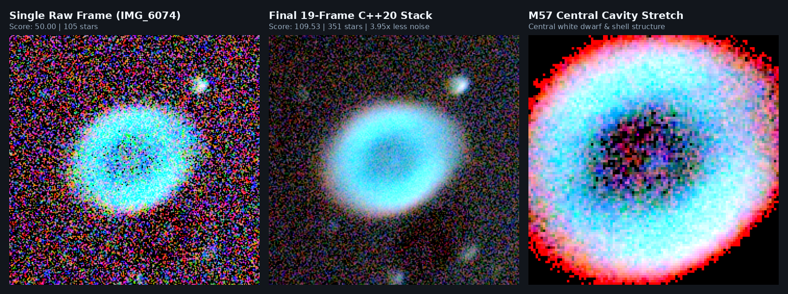
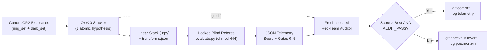
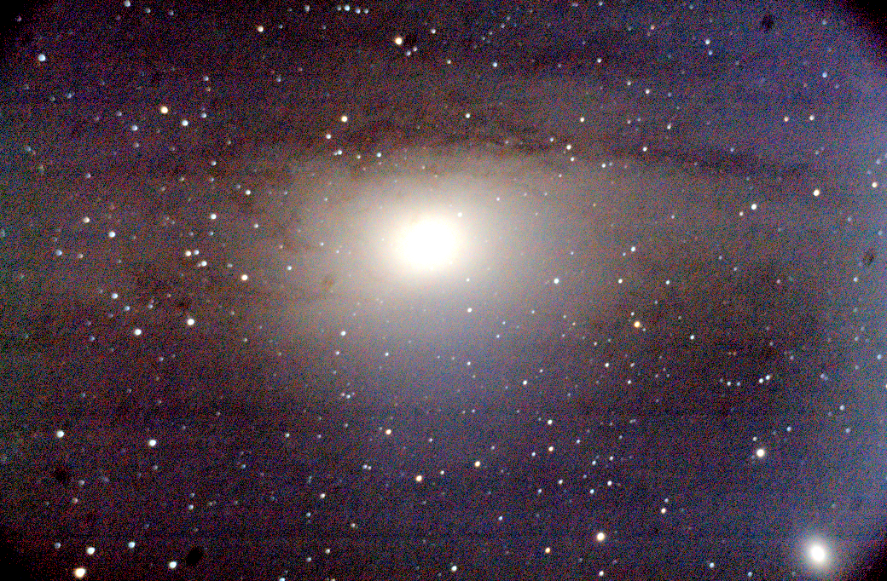
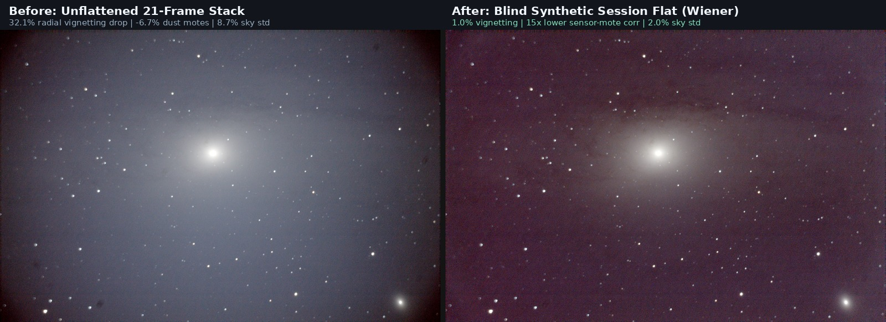

<figure>
  
  <figcaption>Ring Nebula (M57) from a 2020 Canon EOS 1100D session: single sharpest raw frame (left, score 50.0) vs. the final 19-frame C++20 stack evolved autonomously by Carbon without ever viewing an image (middle, score 109.53), and a cavity stretch revealing the central white dwarf (right).</figcaption>
</figure>

**TL;DR:** I rebuilt my 2020 Python astrophotography stacker into a C++20 engine by running **Carbon** inside a blind, anti-Goodhart hill-climbing harness—an immutable referee (`chmod 444`), fresh red-team auditors on every commit, and human stop gates between phases. Over 10 atomic iterations it climbed from `106.02` to `109.53` on the Ring Nebula, generalized zero-shot (`+3.44`) to Andromeda, and uncovered a non-commutative ordering "aha" moment along the way.

📄 [**Read the full technical paper (PDF) →**](/pdfs/2026-11-24-astro-stacker-paper.pdf)

---

## Why I Didn't Just Ask an Agent to "Build a Stacker"

In my earlier posts on [agents and verification](/2025/08/12/agents-and-verification/) and [growing with agents](/2025/12/23/growing-with-agents/), I argued that agents pay off most when verification is cheap, objective, and separated into discrete stages.

Astrophotography stacking is a classic trap for naive AI coding:

- If you let a vision model eyeball stretched JPEGs, it can easily fool itself (or you) with subtle smoothing, dark-floor clipping, or contrast stretches that *look* cleaner while destroying real linear photometry.
- If you give an optimizer a naive scalar metric like *"minimize background noise,"* Goodhart's Law kicks in immediately—it will quietly blur the image, clip negative noise excursions to zero, or drop blurry frames until the number looks great and the science is ruined.

So instead of eyeballing outputs, I designed a **blind, autonomous hill-climbing harness** orchestrated by Carbon (spawning fresh subagents for parallel research, adversarial torture-testing, and independent code audits).

---

## The Technique: Five Operating Laws for Hill-Climbing with Carbon

Before writing a single line of C++, I locked in five non-negotiable rules:

1. **Strict Image & Binary Quarantine:** Never feed raw `.CR2`, `.tif`, `.fits`, or `.npy` pixels into the LLM context. Every interaction with image data happens through code that emits compact JSON telemetry (percentiles, FWHM, star counts, noise ratios, correlation metrics).
2. **Discrete Phase Separation with Human Stop Gates:** Break the project into **4 strictly gated phases**—*Forensics*, *Blind Referee & Planning*, *Autonomous Hill-Climbing*, and *Synthesis*. At the end of every phase, Carbon writes a Markdown report and **comes to a complete stop** until I review it and add guardrails for the next phase.
3. **Lock the Referee Before Optimizing (`chmod 444`):** Build and adversarially torture-test a self-contained Python referee (`scripts/evaluate.py`, stdlib + NumPy only) in Phase 2. Once approved, lock both the referee and the reference `.npy` arrays read-only (`chmod 444`) so the optimizer can never move the goalposts.
4. **Fresh Isolated Red-Team Auditor on Every Step:** Every time an atomic C++ mutation beats the incumbent score, Carbon must spawn a **brand-new subagent** that did not write the code. Its job is adversarial: inspect `git diff cpp_stacker/`, `logs/transforms.json`, and the evaluator JSON assuming the developer is trying to cheat. Only `score > best` **and** `AUDIT_PASS` earns a git commit; anything else gets immediately reverted (`git checkout -- cpp_stacker/`), while keeping the failed postmortem in `logs/` (gitignored so rollbacks never erase memory).
5. **Strict Train / Holdout Split:** Hill-climb exclusively on `ring_set` (M57, a sparse star field with a compact planetary nebula). Never touch `andromeda_set` (M31, a field-filling spiral galaxy with 2.6× more field rotation and a 16 °C warmer sensor) until the loop has converged—then run the winning binary **zero-shot with zero retuning**.

---

## Step-by-Step Walkthrough of the 4 Phases

### Phase 1: Forensics Before Code

Before designing any new algorithm, Carbon audited my 2020 Python codebase (`legacy_2020/`) and profiled all 62 raw `.CR2` files from the 36.5-minute observing session.

That audit immediately explained why my 2020 full-frame spatial cross-correlation ($C_{\mathbf{k}}$) had struggled—even aside from `uint8` overflow and sRGB gamma bugs:

- **Coherent zero-lag dark-residual spike:** Subtracting the same finite $N_D$-frame master dark imprints the exact same static estimation error onto every light frame, creating a sensor-locked spike at lag $\mathbf{k} = \mathbf{0}$ that ensemble averaging across frame pairs *cannot* attenuate.
- **Stationary vignetting & extreme sparsity:** Prime-focus illumination drops to `~0.64` in the corners across 100% of pixels, while stars occupy **less than 0.2%** of the 12.25-megapixel sensor.
- **Oscillatory worm-gear drift & field rotation:** Mount drift reversed direction mid-session (step sizes spanning `1.19–13.61 px`), and polar misalignment rotated corner stars by up to `2.52 px` on M31.

Even better, raw `.CR2` forensics caught **three real-world data hazards** before we wrote a single line of C++:

1. **Five corrupted lossless-JPEG `.CR2` bitstreams**—including a *silent predictor underflow* in `dark_set/IMG_6096.CR2` where `LibRaw` returned zero errors (`LIBRAW_SUCCESS`), yet rows drifted down to `743 ADU`. Catching it required a dual physics gate (`data_error_count == 0`, `max <= 16383`, `p1 >= 1850 ADU`).
2. **The zenith EXIF `flip = 5` trap:** Pointing near zenith for M57 tripped the DSLR's internal gravity sensor to `90° CCW`, while `dark_set` and `andromeda_set` stayed at `flip = 0`. Auto-orienting readers silently transposed the lights against the darks.
3. **Outdoor thermal cooling (`34 °C → 18 °C`):** The camera cooled continuously from M31 (`34 → 21 °C`) through M57 (`24 → 19 °C`) down to the capped darks (`18 °C`), leaving uncompensated warm pixels that bloom into 5-to-9 pixel crosses under `5×5` demosaicing.

At **Stop Gate 1**, I reviewed the report and added four guardrails for Phase 2: keep the referee 100% self-contained (`chmod 444`), use sharp linear Malvar–He–Cutler `5×5` demosaicing for the reference arrays, enforce minimum integrated frame counts (`>= 18` on M57, `>= 20` on M31), and forbid subtracting fine `64×64` background meshes from output pixels so Andromeda's diffuse disk could never be erased.

---

### Phase 2: Building & Torture-Testing the Blind Referee

Carbon built `scripts/evaluate.py` (1,121 lines, pure Python stdlib + NumPy) anchored so that evaluating the sharpest single raw frame (`IMG_6074.CR2`) against itself scores **exact `50.0`**:

$$
\begin{aligned}
\text{Score} = 50 &+ 25\log_2\left(\frac{\sigma_{\text{bg}}^{\text{ref}}}{\sigma_{\text{bg}}^{\text{stack}}}\right) + 35\log_2\left(\frac{\text{FWHM}_{\text{eff}}^{\text{ref}}}{\text{FWHM}_{\text{eff}}^{\text{stack}}}\right) \cr
&+ 10\log_2\left(\frac{N_\star^{\text{stack}}}{N_\star^{\text{ref}}}\right) + 15\big(e_{\text{ref}} - e_{\text{stack}}\big) - 40\big(1 - \rho_{\text{ext}}\big)
\end{aligned}
$$

Two design choices made this objective hard to game:

- **Sharpness outweighs noise (`35` vs. `25` per octave)**, and $\text{FWHM}_{\text{eff}}$ blends `65%` median FWHM with `35%` corner FWHM to reward rotational alignment.
- **Nine hard anti-cheat gates (`Gates 0–5`)** immediately force `score = -inf` on NaN/channel collapse, dark-floor clipping (`> 0.05%` identical sky values), spatial smoothing (even a subtle $\sigma = 0.8\text{ px}$ Gaussian blur trips `4×4` noise-correlation ratios), forged `transforms.json` frame counts (checked against Kish $N_{\text{eff}}$ and empirical Poisson bounds), fine-mesh nebula erasure (`extended_flux_preservation < 0.85`), or non-linear gamma stretches.

Before locking it, an independent **Adversarial Torture-Tester** subagent ran **28 black-box attack scenarios** across both datasets—catching four subtle calibration bugs in the evaluator itself—until all `28 / 28` tests passed. At **Stop Gate 2**, I approved Phase 2, locked `scripts/evaluate.py` and the reference arrays with `chmod 444`, and turned Carbon loose on Phase 3.

---

### Phase 3: The 10-Step Atomic Hill-Climb (`106.02 → 109.53`)

<figure>
  
  <figcaption>The complete 10-iteration hill-climb on <code>ring_set</code> (M57): 7 kept commits (green), 4 reverted hypotheses (red), and the non-commutative ordering breakthrough between Iterations 1–2 and 7–8.</figcaption>
</figure>

Every iteration tested **one atomic algorithmic hypothesis** in `cpp_stacker/`, ran the locked referee, and—if the score improved—faced a fresh Red-Team Auditor:

| Iter | Atomic Hypothesis | Verdict | Score | $\Delta$ vs. Best | Key Takeaway |
| :---: | :--- | :---: | :---: | :---: | :--- |
| **Ref** | Single sharpest raw frame (`IMG_6074.CR2`) | Locked | `50.00` | — | `105` stars, `bg_rms = 0.4328` |
| **0** | Clean C++20 baseline: `LibRaw` 14-bit gate, `2048` bias + mean dark, MHC `5×5`, COM centroids, integer shift+add | **KEPT** | **`106.02`** | `+56.02` | `316` stars, `11` warm impulses, `AUDIT_PASS` |
| **1** | Optical-black (OB) row pedestal + Winsorized dark + thermal scaling + cross-color CFA warm-pixel repair | **REVERTED** | `105.31` | `-0.71` | Warm impulses `11 → 0`, but corner FWHM worsened (`14.66 → 15.24 px`) |
| **2** | Same sensor calibration, but switched to pure same-color (`r=2` vs `r=18`) CFA warm-pixel repair | **REVERTED** | `105.23` | `-0.79` | Still degraded `corner_fwhm` (`15.35 px`)—something deeper was going on! |
| **3** | Detection-only `64×64` SEP background mesh + 7-DOF Levenberg–Marquardt Gaussian centroids + 2D Lanczos-3 sub-pixel shift | **KEPT** | **`107.36`** | **`+1.34`** | Biggest single jump; `+27` faint stars (`316 → 343`), `AUDIT_PASS` |
| **4** | Chiral Valdes triangle geometric hashing + RANSAC/IRLS 4-DOF Similarity (`dx, dy, dθ, s`), same Lanczos-3 kernel | **KEPT** | **`107.70`** | `+0.34` | Sharpened corners by `-0.23 px`; registration ran in `68 ms`, `AUDIT_PASS` |
| **5** | Upgrade 4-DOF Similarity to 6-DOF Full Affine (anisotropic shear/scale) | **REVERTED** | `107.37` | `-0.32` | Overfit off-axis Newtonian coma on a 10-minute track; corners worsened |
| **6** | Per-frame photometric flux scaling + 1st-degree differential sky plane (`I_i/F_i - I_ref`) + PSF/SNR frame weights | **KEPT** | **`108.64`** | **`+0.94`** | Sharper than the 18-frame exposure median (`10.89 < 10.90 px`), `AUDIT_PASS` |
| **7** | Per-pixel **temporal Winsorized Sigma Clipping** ($\kappa = 2.8$, with seeing-variance floor) on the 18 clean frames | **KEPT** | **`108.82`** | `+0.18` | Warm impulses **`32 → 0`** purely along time—zero spatial filtering! `AUDIT_PASS` |
| **8** | **Retry pure sensor calibration** from Iter 1–2 (33-row OB pedestal + Winsorized dark + thermal scaling, *zero* spatial CFA repair) | **KEPT** | **`109.19`** | **`+0.37`** | **The breakthrough:** sharpest center (`10.85 px`) and corners (`14.86 px`), `AUDIT_PASS` |
| **9** | Two-pass directional Hamilton–Adams demosaicing vs. linear MHC `5×5` | **REVERTED** | `108.24` | `-0.95` | Softened oversampled astronomical PSFs (`9–15 px`) and raised noise |
| **10** | Stencil-isolated partial-row salvage of `IMG_6089.CR2` (top `2,468` clean rows before bitstream fault) | **KEPT** | **`109.53`** | `+0.33` | `19` frames, **`351` stars** (`3.34×`), **`3.95×` lower sky RMS**, `AUDIT_PASS` |

---

## The "Aha" Moment: Hill-Climbing Is Non-Commutative

Look closely at **Iterations 1 & 2** versus **Iterations 7 & 8**. That was the moment the whole methodology paid for itself.

In **Iterations 1 and 2**, Carbon tried what every astrophotography textbook tells you to do first: subtract the optical-black readout pedestal, build a Winsorized master dark, scale thermal dark current, and repair warm pixels on the raw Bayer lattice before demosaicing.

Both iterations **regressed** (`-0.71` and `-0.79`) and were cleanly reverted. A naive hill-climber—or an impatient human—would have crossed sensor calibration off the list and never looked back.

Because we forced a **root-cause postmortem on every reverted step**, we uncovered two layers of hidden physics:

1. **In Iteration 1**, the cross-color warm-pixel guard (`r = 1` vs. `r = 8.06 px`) accidentally shaved the central Green pixel of wide comatic corner stars (`FWHM ≈ 15 px`), because `r = 8 px` was still inside the star's own halo.
2. **In Iteration 2**, fixing that bug with a same-color guard (`r = 2` vs. `r = 18 px`) *still* hurt `corner_fwhm` (`14.66 → 15.35 px`)! Why? Looking at `transforms.json` exposed a subtle artifact of `Iter 0`: without temporal outlier rejection, five worm-gear turnaround exposures (`IMG_6077..6082`) clustered within `2–4 px`, smearing stationary warm pixels into compact `~4 px` fake "stars" in the sparse corners. Those fake pinpoint blobs had been artificially making `Iter 0`'s corners *look* sharper than the real comatic stars!

That diagnosis changed the order of operations:

- Instead of fighting warm pixels with **spatial** single-frame interpolation, **Iteration 7** deferred outlier rejection to **temporal Winsorized Sigma Clipping** along the aligned exposure stack (with a seeing-variance floor so sharp vs. blurry star cores aren't clipped). Warm-pixel impulses dropped from **`32 → 0`** with zero spatial blurring.
- Then, in **Iteration 8**, we re-introduced the *exact* physical sensor calibration that had failed in Iterations 1–2 (33-row optical-black pedestal + Winsorized master dark + thermal dark scaling, with **zero** spatial CFA interpolation). With the warm-pixel confound removed orthogonally along the time axis, both center and corner FWHM sharpened immediately for a clean **`+0.37` gain**.

> **The lesson:** In complex pipelines, a reverted hypothesis is not a dead hypothesis. Algorithmic improvements do not commute—sometimes Step A only works *after* Step B removes the artifact that was masking Step A's benefit. Logging negative-result postmortems is what lets an agent (and its human operator) see when to revisit an earlier idea.

---

## Zero-Shot Generalization on Andromeda (M31) — and Finally Opening the Images

After Stop Gate 3, we took the winning C++20 binary (`2,782` lines of C++20/OpenMP, compiled to a `262 KiB` executable) and ran it **completely unmodified—zero hyperparameter retuning**—on the holdout `andromeda_set` (M31):

| Pipeline on `andromeda_set` (Holdout) | Composite Score | $\Delta$ vs. `iter-0` | `med_fwhm` (px) | `cor_fwhm` (px) | `norm_bg_rms` | `5σ` Stars | Warm Impulses | Disk Fidelity (`ncc_64`) |
| :--- | :---: | :---: | :---: | :---: | :---: | :---: | :---: | :---: |
| Single Raw Frame (`IMG_6044.CR2`) | `50.00` | — | `7.75` | `12.06` | `0.4528` | `107` | — | `1.0000` |
| `iter-0-baseline` (Unmodified) | `111.44` | `0.00` | `8.36` | `12.95` | `0.1005` | `249` | `477` | `0.9996` |
| **`iter-best-final` (Zero Tuning)** | **`114.88`** | **`+3.44`** | **`8.20`** | **`12.59`** | **`0.0967`** | **`264`** | **`0`** | **`0.9996`** |

The zero-shot holdout gain (**`+3.44`**) matched the training gain (**`+3.51`**) within **1.9%**:

- All **`477`** thermal warm-pixel impulses caused by the `34 °C → 21 °C` cooling gap vanished (`477 → 0`).
- Stellar sharpness beat the 21-exposure single-frame median (`8.20 px < 8.28 px`), while 4-DOF Valdes triangle alignment eliminated Andromeda's `2.52 px` corner field rotation—registering all 21 frames in **`33 milliseconds`**.
- Andromeda's extended galactic disk and dust lanes were preserved at **`99.96%`** meso-scale correlation (`structure_rms_ratio = 1.0016`) because our differential sky plane (`I_i / F_i - I_ref`) cancelled stationary astrophysical emission identically.

And when I finally broke the quarantine *after* Phase 4 to inspect the stretched stacks visually, the Ring Nebula's central white dwarf popped right out of the cavity—and Andromeda's dark dust lanes and companion galaxy M32 came through cleanly across the frame:

<figure>
  
  <figcaption>Zero-shot holdout result on Andromeda (M31): 21 exposures stacked with zero retuning, preserving extended disk dust lanes and eliminating all 477 thermal warm-pixel impulses.</figcaption>
</figure>

---

## Bonus Round: Estimating a Blind Synthetic Flat Field

One thing I never shot back in 2020 was a set of physical **flat frames** (uniformly lit exposures used to divide out optical vignetting and sensor dust shadows). Even after stacking cleanly, M31 still carried a **`32.1%` radial vignetting drop** toward the corners and **`-6.7%` dark dust motes** locked to the sensor (you can spot a smudge near the bottom-left corner and upper-right of the unflattened stack).

Using the same iterative hill-climbing workflow—6 iterations guided by a dedicated flat-field diagnostic evaluator (`scripts/evaluate_flat_motes.py`)—I had the AI build a **C++20 synthetic flat-field estimator** (`flat_field.cpp`):

- **Blind session transfer:** Because Andromeda fills the entire frame, estimating a flat directly on M31 risks accidentally dividing out the galaxy itself. Instead, the solver estimates the optical transmission $V(\mathbf{x})$ strictly from the sparse `ring_set` frames (where M57 is tiny and stars drift across the sensor across exposures), then applies that *same* session flat blindly to `andromeda_set`.
- **Two-component model:** A smooth per-channel radial vignetting profile combined with a **coupled-luminance, Wiener-regularized dust-mote map** (`mote_wiener_sigma = 0.003`) that isolates genuine optical shadows (`10–180 px` band-pass) while suppressing high-frequency sky noise.

<figure>
  
  <figcaption>Andromeda (M31) before (left) and after (right) dividing by the blind synthetic session flat estimated solely from <code>ring_set</code>: the 32.1% vignetting bowl and sensor dust motes disappear, letting M31's elliptical disk and dust lanes stand out cleanly.</figcaption>
</figure>

The diagnostic numbers confirm what the eye immediately sees:

- **Radial vignetting drop (`r = 0 → 0.9`):** `32.1% → 1.0%` on M31 (`32.0% → -1.5%` on M57).
- **Quiet-sky uniformity (`rel_std`):** `8.71% → 2.00%` on M31 (`10.39% → 1.48%` on M57—a **7×** flatter sky).
- **Sensor-locked dust-mote correlation** between `ring_set` and `andromeda_set`: dropped **15×** (`0.348 → 0.023`), proving real physical dust shadows were removed rather than astrophysical structure.

*(Fun anti-Goodhart side note: when we fed the flattened stack back into the original locked `evaluate.py`, Gate 4 immediately flagged it—precisely because the locked single-frame reference `ref_andromeda.npy` still has the unflattened `32%` vignetting bowl! That's why flat-fielding needed its own separate diagnostic evaluator rather than unlocking the original referee.)*

---

## Takeaways for Your Own Hill-Climbing Loops

If you want to run a similar autonomous optimization loop with Carbon (or any agentic harness) on a hard engineering problem, five habits made all the difference:

1. **Spend real time on the referee before optimizing.** Adversarial torture-testing caught four subtle evaluator bugs before a single line of C++ existed.
2. **Make the referee read-only (`chmod 444`) and keep an isolated auditor.** Separating the *builder* from the *verifier*—and giving the verifier a fresh context with an adversarial mandate—keeps Goodhart's Law in check.
3. **One atomic hypothesis per commit, with ruthless git rollbacks.** Bundling two changes hides why a score moved.
4. **Never throw away failed runs.** Keeping reverted postmortems in an untracked log is what revealed the non-commutative ordering between Iterations 1–2 and 7–8.
5. **Stay in the loop at phase boundaries, not at every line of code.** Reviewing forensic reports and setting physical guardrails at Stop Gates kept me learning the domain deeply while letting the agent do the heavy lifting—exactly the kind of human-in-the-loop collaboration I want from AI.
