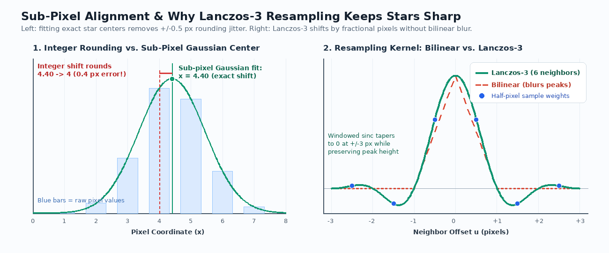
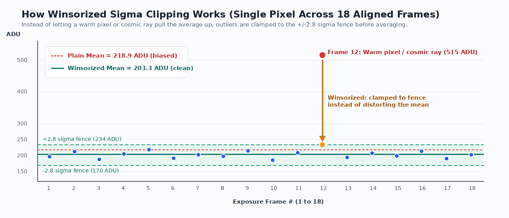
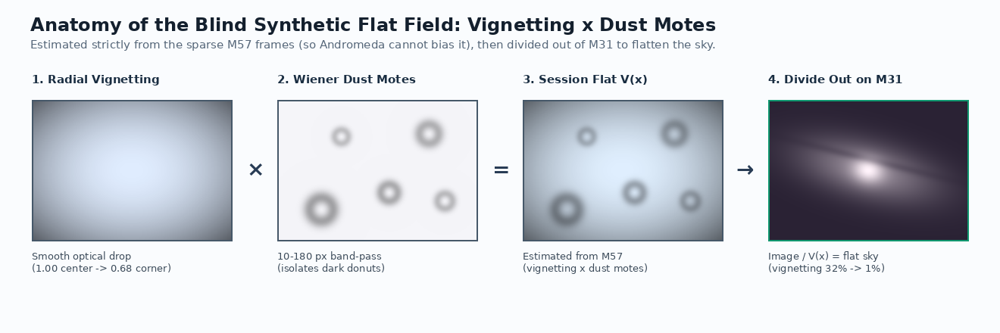
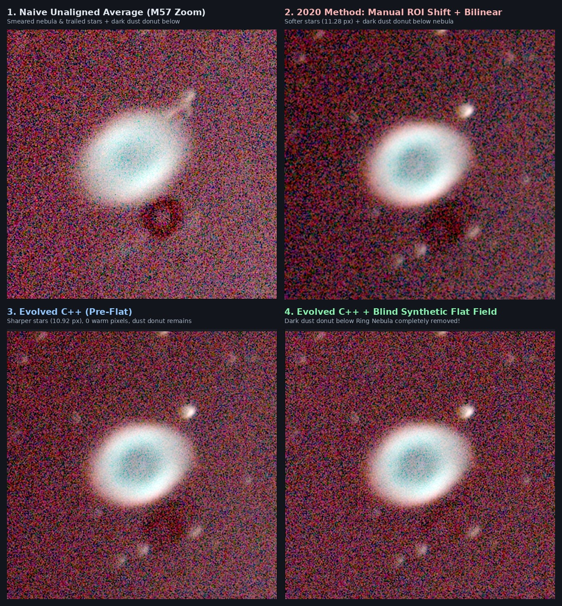
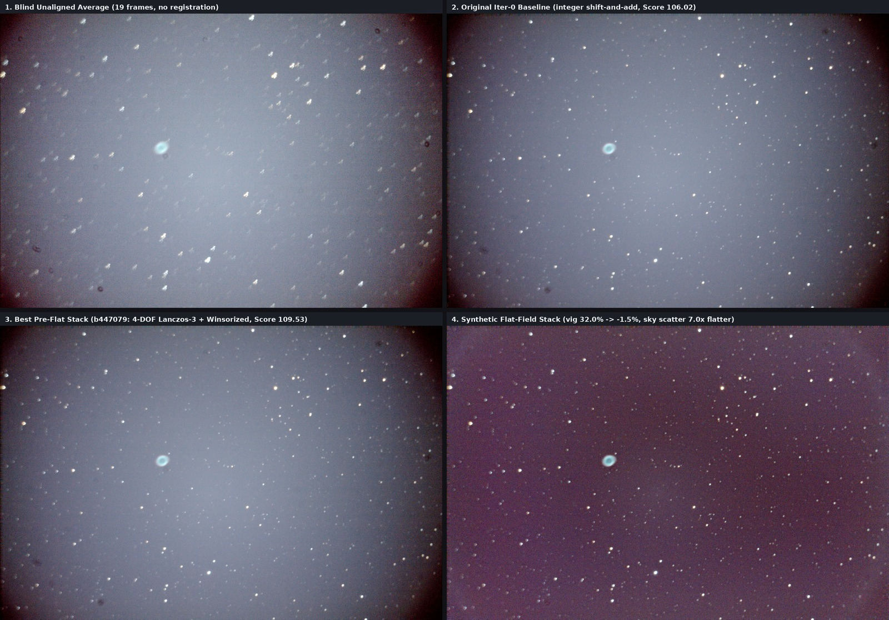

<figure>
  
  <figcaption>Ring Nebula (M57, Canon EOS 1100D): single raw frame (left), final 19-frame C++ stack (middle), and a cavity stretch revealing the central white dwarf (right).</figcaption>
</figure>

**TL;DR:** Back in 2020 I wrote a simple Python script to stack raw telescope photos of the Ring Nebula (M57) and Andromeda (M31) by shifting images to minimize their difference. Here is how I evolved that idea with **Carbon** into a fast C++ stacker, explaining each technique along the way, from star-triangle rotation matching and Winsorized clipping to a blind synthetic flat field.

🖼️ [**Skip straight to the final images →**](#final-results) &nbsp;|&nbsp; 📄 [**Read the full technical paper (PDF) →**](/pdfs/2026-11-24-astro-stacker-paper.pdf)

---

## Where I Started: The 2020 Python Prototype

In 2020, I took 62 raw `.CR2` exposures on a Canon EOS 1100D (21 of the Ring Nebula M57, 21 of the Andromeda Galaxy M31, and 20 capped dark frames) and tried to write my own stacker in Python.

The original idea was simple: subtract the average dark frame, then slide pairs of images over each other and measure their **normalized absolute difference** (and full-frame cross-correlation). Wherever that difference hit a minimum was where I expected the frames to line up.

In practice, that simple approach ran into several conceptual problems:

- **No rotation:** Over a 10-minute session, slight polar misalignment slowly rotates the sky across the sensor (on Andromeda, corner stars rotate by ~2.5 pixels). Pure `(x, y)` shifts can't fix that. *(And yes, the new C++ stacker does account for rotation!)*
- **No flat field (vignetting & dust motes):** Telescope optics darken the corners by ~32% and sensor dust casts dark donut shadows. Because those patterns stay fixed on the camera, whole-image comparison strongly prefers *zero shift* `(0, 0)` instead of following the drifting stars.
- **Temperature drift:** The camera cooled outdoors from `34 °C` at the start of the session down to `18 °C` by the time I took the dark frames. Because silicon dark current roughly doubles every `6 °C`, subtracting a cooler master dark left hundreds of bright "warm pixels" behind.
- **Empty sky dominates whole-image matching:** Stars occupy less than `0.2%` of the 12-megapixel sensor. Correlating the whole image mostly correlates sky noise, vignetting, and leftover dark-frame error.
- **Real-world file & mount quirks:** The mount's worm gear reversed drift direction mid-session, and 5 of the `.CR2` files had corrupted bitstreams.

---

## Step 1: A Clean C++ Baseline (And How We Iterated)

Rather than tuning parameters by eye, I used **Carbon** to hill-climb a fresh C++ rewrite against a **read-only scoring script** and a separate reviewer agent on every commit. The scoring script measures star sharpness, background noise, star count, star roundness, and diffuse-nebula preservation, never showing the model a single pixel and reverting any change that hurts the score. Sharpness is measured by **FWHM** (Full Width at Half Maximum, the width of a star's brightness profile at half its peak; smaller means sharper), tracked both across the whole frame and specifically in the **outer corners of the image** (where field rotation swings stars the farthest and telescope optics are naturally wider).

Even the very first C++ baseline (`Iter 0`) already looked dramatically better than an unaligned average (`+45.7` points on M57, `+48.9` on M31) because it fixed the fundamentals at a high level:

1. **True 14-bit linear raw reading** directly via [LibRaw](https://github.com/LibRaw/LibRaw), automatically rejecting corrupted `.CR2` bitstreams.
2. **Clean master-dark subtraction** without clipping negative noise values to zero.
3. **Sharp linear demosaicing** ([Malvar-He-Cutler](https://www.ipol.im/pub/art/2011/g_mhcd/) `5×5`) instead of blurry consumer gamma-stretched JPEGs.
4. **Star-based alignment** instead of whole-image correlation, followed by simple shift-and-add averaging.

### How Star-Based Alignment Works
My original whole-image shift-and-difference idea was actually the unconventional approach. I had hoped comparing every pixel would give a cleaner signal, but on deep-sky photos where stars occupy less than `0.2%` of the sensor, whole-image matching gets drowned out by sky noise and vignetting.

In astronomy, the standard way to align deep-sky frames is **star-based registration** (the same general idea used by tools like PixInsight, Siril, and DeepSkyStacker). Instead of sliding whole images across each other, the C++ stacker aligns every exposure in three clean steps:

1. **Find the stars:** Convert each calibrated frame to grayscale luminance, estimate the local sky brightness and noise on a coarse grid (used only for detection, never subtracted from the final image), and pick out connected bright blobs rising `5σ` above the local background (filtering out single-pixel spikes and saturated star cores). We keep the top ~60 brightest stars and record their `(x, y)` centers.
2. **Compute the shift (and later, rotation):** Match each frame's star `(x, y)` coordinates to the reference frame's star coordinates to solve the exact offset between the two exposures.
3. **Resample and combine:** Shift (or rotate) each frame's pixels onto the reference grid and stack them together.

That clean baseline already got us ~90% of the way there. Next, we refined each stage one technique at a time.

---

## Step 2: Refining the Stacker, Technique by Technique

### 1. Sub-Pixel Alignment & Lanczos-3 Resampling (`Iter 3`)
In the baseline, we measured star centers with a simple center-of-mass and rounded each frame's shift to the nearest whole pixel, introducing up to `±0.5 px` of jitter per frame and softening star cores. Here we upgraded Step 1 to fit smooth **2D Gaussian centers** to the ~60 brightest stars purely to measure the exact fractional shift (for example, `dx = +10.40 px, dy = -3.72 px`).

To actually shift all 12.25 million pixels by a fractional amount like `0.4` pixels, we have to **interpolate** between grid points (an image array has no index `2.4`). **Lanczos-3 resampling** (Step 3) does this with a fixed weighted average of the 6 nearest neighbors rather than any curve fitting. For example, on a 1D slice of pixels `[10, 12, 80, 100, 15, 11]`, interpolating at `x = 2.4` multiplies each neighbor by its fixed Lanczos-3 weight and sums them up:

```
in[2.4] = 0.02(10) - 0.14(12) + 0.72(80) + 0.46(100) - 0.08(15) + 0.02(11) = 101.1
```

By contrast, simple **bilinear** interpolation only averages the two closest pixels (`0.60(80) + 0.40(100) = 88.0`), squashing the star peak from `101` down to `88`. Extending that `6`-neighbor weighted sum to a `6×6` patch in 2D works no matter how large the shift is (even 50+ pixels), because we jump by the whole-pixel shift first and only use the `6×6` grid for the fractional remainder between `0` and `1`. What actually matters is that the `6×6` window captures the local point spread function (PSF) cleanly, keeping stars crisp and giving our biggest single refinement jump (`+1.34`).

<figure>
  
  <figcaption>Left: 2D pixel grid around a star PSF. After jumping by the whole-pixel shift, the 6×6 Lanczos-3 grid comfortably spans the star's spread around the fractional target (yellow crosshair), unlike a 2×2 bilinear box. Right: the 6-neighbor windowed sinc weights at a +0.40 px shift.</figcaption>
</figure>

### 2. Handling Rotation with Star-Triangle Matching (`Iter 4`)
Once you have ~60 star `(x, y)` coordinates in the reference frame and ~60 in a later frame, how do you know which star is which when the sky has both drifted and rotated? We upgraded Step 2 with **Valdes star-triangle geometric hashing**: pick bright stars and form triangles out of them. The *ratios* of a triangle's side lengths `(L1/L2, L0/L2)` stay identical no matter how much the frame shifts, rotates, or zooms. Matching those triangles identifies ~50 corresponding star pairs across the two frames, and a least-squares fit on those matched coordinates solves the exact 4-DOF similarity transform `(dx, dy, rotation, scale)`.

<figure>
  
  <figcaption>Star-triangle matching: because a triangle's side-length ratios are invariant to shift and rotation, matching star triangles recovers both drift and field rotation cleanly.</figcaption>
</figure>

*(We also tested a 6-DOF full affine transform in `Iter 5`, which overfit off-axis coma and hurt corner sharpness, so it was automatically reverted.)*

### 3. Differential Sky-Plane Equalization & Smart Frame Weighting (`Iter 6`)
As a target moves across the sky, light pollution and skyglow shift slightly from one exposure to the next (one frame may be slightly brighter overall, or brighter on one side). If you tried to estimate and subtract the background directly from each frame, it's easy to mistake Andromeda's huge glowing disk for "bright sky" and accidentally erase part of the galaxy.

The trick is to **subtract the aligned reference frame first**: because both aligned frames contain the exact same galaxy in the exact same pixels, taking `Frame - Reference` cancels out Andromeda and the stars completely, leaving *only* the change in skyglow between the two shots. We split that difference image into coarse `96×96` patches, take the median of each patch, and fit a simple flat tilted sheet (`a + bx + cy`) across them. Subtracting that sheet brings every frame to the same sky level without ever touching the galaxy.

<figure>
  
  <figcaption>Differential sky-plane equalization: subtracting the aligned reference frame cancels Andromeda's glowing disk completely, leaving only the tilted skyglow shift to fit and remove.</figcaption>
</figure>

Finally, instead of giving every exposure equal weight, we weight sharper, cleaner frames higher than frames blurred by mount drift, making the combined stack sharper than the median single exposure (`+0.94`).

### 4. Winsorized Sigma Clipping (`Iter 7`)
Even after aligning stars, temperature drift left behind bright **warm pixels** (and occasional cosmic rays) that trace faint red/blue streaks across the stack when you take a plain average.

**What does "Winsorized" mean?** Look at a single pixel across 18 aligned exposures: 17 frames cluster around the true sky value (`~200 ADU`), while 1 frame has a warm-pixel spike (`515 ADU`).
- A **plain mean** gets pulled up by the spike.
- A **pure median** ignores the spike, but throws away statistical efficiency (~25% noisier).
- **Winsorized sigma clipping** computes the robust center and spread (median & MAD), sets a `±2.8σ` fence, and **clamps** any outlier back to the fence before averaging.

<figure>
  
  <figcaption>Winsorized sigma clipping on a single pixel across 18 frames: clamping the Frame 12 warm-pixel spike to the ±2.8σ fence keeps the mean clean without losing the noise-reduction benefit of averaging.</figcaption>
</figure>

On M57, warm-pixel artifacts dropped from **`32 → 0`**; on M31, all **`477` warm-pixel streaks vanished**, with zero spatial blurring.

### 5. The "Aha" Moment: Sensor Calibration *After* Temporal Clipping (`Iter 8`)
A camera sensor actually has a narrow strip of pixels along its left edge (`58` columns wide on the Canon 1100D) that is physically covered by an opaque shield so **no light ever hits it**. Because it sits in total darkness, this **optical-black border** measures the camera's pure electronic baseline ("pedestal," around `2048 ADU`), which drifts slightly from row to row and frame to frame.

Early on (`Iter 1` and `Iter 2`), we tried upgrading our dark calibration using three physical improvements: subtracting each row's optical-black border median, building a Winsorized master dark, and scaling the dark frame to compensate for temperature drift (plus trying to patch warm pixels in each frame). Surprisingly, **both attempts hurt the score (`-0.71` and `-0.79`) and were reverted!**

Why would better sensor calibration make the score worse? Looking at the failed logs revealed a subtle flaw in the **scorer itself**. To prevent single hot pixels from dominating the sharpness score, the scoring script defensively filtered out 1-pixel hotspots. A warm pixel is a defect stuck at one fixed spot on the camera sensor (left bright because the camera was warmer during the light shots than during the darks). However, **shifting the frames to align the stars** also shifts those stuck bad pixels along with each frame. In `Iter 0` (before we had Winsorized clipping across frames), five exposures only drifted `2` to `4` pixels, so shifting them piled each warm pixel right next to itself into a `~4 px` blob in the corners of the image. Shifting the bad pixels across multiple pixels made them unremovable by the scorer's 1-pixel defense, yet still small enough to drag the measured corner star width down artificially. When `Iter 1` and `Iter 2` removed those warm pixels, the fake `~4 px` blobs vanished and the true, wider optical corner stars (`~15 px`) showed up, which looked like a drop in sharpness.

Once `Iter 7` added Winsorized sigma clipping across the stack, those smeared hotspots were removed properly along the time axis, overcoming the scorer's blind spot. Re-applying pure sensor calibration in `Iter 8` (optical-black row pedestal + Winsorized master dark + temperature dark scaling, with no single-frame pixel patching) was finally compared apples-to-apples on real stars, immediately jumping **`+0.37`** and hitting the sharpest star FWHM of the entire run.

**The takeaway:** No automated score is perfect, and a human still needs to inspect what the score is actually rewarding. Even so, the scorer was good enough that `Iter 0`'s blind spot was only a shallow **artificial local minimum**: to reach the genuinely deeper optimum, the pipeline still had to solve the underlying physics properly.

<figure>
  
  <figcaption>The scorer blind spot behind the "Aha" moment: smeared ~4 px warm-pixel blobs slipped past the scorer's 1-pixel hotspot filter and pulled Iter 0's corner FWHM down. Once Winsorized clipping (Iter 7) removed them, pure sensor calibration (Iter 8) sharpened real corner stars cleanly.</figcaption>
</figure>

<figure>
  
  <figcaption>Hill-climbing with an imperfect score: a scorer blind spot can create a shallow artificial local minimum (Iter 0), making direct fixes look worse at first (Iter 1–2), but reaching the true deeper minimum still requires fixing the underlying physics (Iter 3–10).</figcaption>
</figure>

### 6. Partial-Row Bitstream Salvage (`Iter 10`)
One M57 exposure (`IMG_6089.CR2`) had a bitstream glitch only in its bottom 4 strips. Scanning rows top-down let us safely salvage its clean top `2,468` rows (keeping a 10-row safety margin away from the glitch so our `6×6` Lanczos-3 stencil never touches corrupted pixels), boosting us from 18 to **19 integrated frames** (`+0.33`).

<figure>
  
  <figcaption>Partial-row bitstream salvage on IMG_6089.CR2: keeping a 10-row safety margin above the corrupted bottom strips lets us salvage 86.4% of the exposure cleanly, increasing coverage to 19 frames across most of the image.</figcaption>
</figure>

---

## Step 3: Estimating a Blind Synthetic Flat Field

Everything above solved alignment, rotation, temperature drift, and noise, but because I never shot physical **flat frames** in 2020, both stacks still had the telescope's **`32%` radial vignetting bowl** and dark **sensor dust donuts**.

You can't easily estimate a flat directly from Andromeda because the galaxy fills the whole frame. Instead, we ran a follow-up flat-field pass (`flat_field.cpp`) that:
1. Estimates the optical transmission strictly from the sparse **Ring Nebula (`ring_set`)** frames, where M57 is tiny and stars drift across the sensor.
2. Separates the flat into two components: a smooth per-channel **radial vignetting curve** plus a **Wiener-regularized dust-mote map** (band-passed to `10–180 px` so it catches dust donuts without amplifying pixel noise).
3. Divides that *same* session flat blindly out of **Andromeda (`andromeda_set`)**.

<figure>
  
  <figcaption>The blind synthetic flat field decomposes optical illumination into smooth radial vignetting multiplied by a band-passed Wiener dust-mote map, estimated from M57 and divided out of M31.</figcaption>
</figure>

The result: radial vignetting collapsed from **`32.1% → 1.0%`** on M31 (`32.0% → -1.5%` on M57), quiet-sky scatter became **4.4× to 7.0× flatter**, and cross-dataset sensor dust-mote correlation dropped **15×** (`0.348 → 0.023`).

---

## Putting It All Together: Plot & Summary Table

To measure true end-to-end gain, the chart and tables below use the **unaligned dark-subtracted mean** as `0.00` (raw score `60.28` on M57, `62.57` on M31) and plot how much each technique improved above it. Even with every stage enabled, the parallel C++/OpenMP engine processes an entire session of ~40 raw `.CR2` files end-to-end in roughly **70 to 90 seconds** (compared to several minutes in the original 2020 Python prototype):

<figure>
  
  <figcaption><strong>Top:</strong> M57 score gain above the unaligned dark-subtracted mean baseline (<code>60.28 → 0.0</code>). <strong>Bottom:</strong> M31 flat-field diagnostics showing vignetting drop, sky uniformity, and dust-mote removal.</figcaption>
</figure>

| Stage / Technique | What It Does | M57 $\Delta$ vs. Base | M31 $\Delta$ vs. Base | Key Impact |
| :--- | :--- | :---: | :---: | :--- |
| **Unaligned Mean (Base)** | Dark-subtracted average, no alignment | `0.00` (`60.28`) | `0.00` (`62.57`) | Star trails (`FWHM 16.0 / 13.5 px`) |
| **It 0: C++ Baseline** | 14-bit raw, MHC `5×5`, star shift+add | `+45.74` | `+48.86` | Stars snap sharp; `316 / 249` stars |
| **It 3: Sub-Pixel Lanczos-3** | Gaussian star centers + fractional shift | `+47.08` | - | `+27` faint stars, sharper cores |
| **It 4: Valdes 4-DOF Rotation** | Star-triangle matching (`dx, dy, dθ, s`) | `+47.42` | - | Fixes `2.5 px` corner rotation |
| **It 6: Sky Plane + PSF Weights** | Differential sky plane + sharpness weights | `+48.36` | - | Beats single-frame median FWHM |
| **It 7: Winsorized Clipping** | Clamps temporal outliers to `±2.8σ` fence | `+48.55` | - | Warm-pixel streaks `32 → 0` (`477 → 0` M31) |
| **It 8: OB + Thermal Dark** | Row bias + Winsorized dark + temp scaling | `+48.92` | - | **Aha moment:** `+0.37` *after* It 7 |
| **It 10: Partial-Row Salvage** | Recovers clean top `2,468` rows of bad `.CR2` | `+49.25` | `+52.31` | `19` frames, `351` stars, `3.95×` less noise |
| **Flat F2: Dust-Mote Solver** | Iterative sky-model dust-mote flat | **`+49.31`** | **`+53.38`** | Highest locked-referee score (`109.58 / 115.95`) |
| **Flat F6: Full Session Flat** | Blind radial vignetting + Wiener motes | *flat sky*\* | *flat sky*\* | Vignetting `32% → 1%`, **15×** less dust corr |

*\*The locked referee compares against an unflattened single frame, so removing the `32%` vignetting bowl is evaluated with a dedicated flat-field diagnostic (`evaluate_flat_motes.py`).*

---

## Final Results {#final-results}

Here is the full 4-stage visual progression, from **(1) unaligned average** → **(2) Iter-0 baseline** → **(3) best pre-flat stack** → **(4) final synthetic flat-field stack**, on both targets:

### Ring Nebula (M57): Zoomed View
Notice the dark dust-mote donut right below the Ring Nebula in panels 1 to 3 disappearing cleanly in panel 4:

<figure>
  
</figure>

### Ring Nebula (M57): Full Field
Radial vignetting drops from `32.0%` to `-1.5%`, and the background sky becomes `7.0×` flatter:

<figure>
  
</figure>

### Andromeda Galaxy (M31): Zero-Shot Holdout + Blind Flat
Processed with zero retuning, then flattened using the synthetic flat estimated solely from M57, bringing out M31's elliptical disk, dark dust lanes, and companion galaxy M32 in the lower right:

<figure>
  
</figure>
