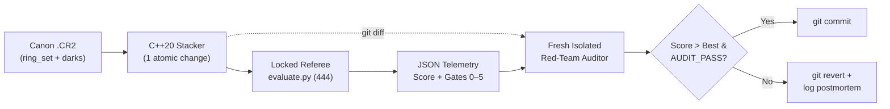

<figure>
  
  <figcaption>Ring Nebula (M57, Canon EOS 1100D): single sharpest raw frame (score 50.0) vs. final 19-frame C++20 stack evolved blind by Carbon (score 109.53) vs. central cavity stretch showing the white dwarf.</figcaption>
</figure>

**TL;DR:** I rebuilt my 2020 Python astrophotography stacker into a C++20 engine by hill-climbing with **Carbon** inside a blind, anti-Goodhart harness—a locked referee (`chmod 444`), fresh red-team auditors on every commit, and human stop gates. Relative to a dark-subtracted unaligned mean baseline (`0.00`), 10 core iterations plus a synthetic flat-field pass gained **`+49.31`** on M57, generalized zero-shot (**`+53.38`**) to Andromeda, and cut radial vignetting from `32.1%` to `1.0%`.

📄 [**Read the full technical paper (PDF) →**](/pdfs/2026-11-24-astro-stacker-paper.pdf)

---

## The Technique: Blind Anti-Goodhart Hill-Climbing

Astrophotography is easy to accidentally game: a subtle blur lowers sky noise, dark-floor clipping hides noise, and eyeballing JPEGs hides photometric distortion. To force real algorithmic progress, I put Carbon inside five strict rules across **4 human-gated phases** (*Forensics → Blind Referee → C++20 Hill-Climb → Synthesis*):

- **Image Quarantine:** Zero pixels ever enter the LLM context—all reasoning uses compact JSON telemetry.
- **Forensics First (Phase 1):** Audited `legacy_2020/` (why full-frame cross-correlation $C_{\mathbf{k}}$ locks onto zero lag) and raw `.CR2` headers—catching 5 corrupted bitstreams (including a silent `LibRaw` underflow), a zenith EXIF `flip = 5` rotation trap, and a `34 °C → 18 °C` cooling curve.
- **Locked Blind Referee (Phase 2):** Built a pure-NumPy evaluator (`scripts/evaluate.py`, anchored at `50.0` on a single frame) with 9 hard anti-cheat gates, verified it across **28/28 adversarial torture tests**, and locked it read-only (`chmod 444`).
- **Atomic Commits + Fresh Red-Team Auditor (Phase 3):** One hypothesis per step. Every winning diff is audited by a fresh subagent (`AUDIT_PASS` required); regressions are immediately `git checkout`-reverted while keeping postmortem logs.
- **Strict Holdout:** Optimize only on M57 (`ring_set`); test zero-shot with zero tuning on Andromeda (`andromeda_set`).

The locked composite objective weights sharpness (`35/octave`) heavier than noise (`25/octave`) so blurring always loses points even before hard gates fire:

$$
\begin{aligned}
\text{Score} = 50 &+ 25\log_2\left(\frac{\sigma_{\text{bg}}^{\text{ref}}}{\sigma_{\text{bg}}^{\text{stack}}}\right) + 35\log_2\left(\frac{\text{FWHM}_{\text{eff}}^{\text{ref}}}{\text{FWHM}_{\text{eff}}^{\text{stack}}}\right) \cr
&+ 10\log_2\left(\frac{N_\star^{\text{stack}}}{N_\star^{\text{ref}}}\right) + 15\big(e_{\text{ref}} - e_{\text{stack}}\big) - 40\big(1 - \rho_{\text{ext}}\big)
\end{aligned}
$$

---

## The Hill-Climb: Plot & Score Table

<figure>
  
  <figcaption><strong>Top:</strong> M57 score gain above the unaligned dark-subtracted mean baseline (<code>60.28 → 0.0</code>) across 10 core iterations (7 kept, 4 reverted) + flat-field dust-mote solver (F2: <code>+49.31</code>). <strong>Bottom:</strong> M31 synthetic flat-field diagnostics—vignetting drops from 32.1% to 1.0% and sensor dust-mote correlation drops 15×.</figcaption>
</figure>

### Core Evolution (`ring_set`, M57) + Flat-Field Pass

| Step | Atomic Hypothesis | Verdict | $\Delta$ vs. Base | Raw Score | FWHM (px) | Sky RMS | Stars | Warm Imp. |
| :---: | :--- | :---: | :---: | :---: | :---: | :---: | :---: | :---: |
| **Base** | **Unaligned dark-subtracted mean** (18 clean frames, no registration) | Baseline | **`0.00`** | `60.28` | `15.99` | `0.1234` | `82` | — |
| **It 0** | C++20 baseline: 14-bit gate, mean dark, MHC `5×5`, int shift+add | **KEPT** | **`+45.74`** | `106.02` | `11.18` | `0.1149` | `316` | `11` |
| **It 1** | OB pedestal + Winsorized dark + thermal scale + cross-color CFA repair | REVERTED | `+45.03` | `105.31` | `11.21` | `0.1147` | `318` | `0` |
| **It 2** | Same sensor calibration + same-color (`r=2` vs `18`) CFA repair | REVERTED | `+44.95` | `105.23` | `11.21` | `0.1147` | `320` | `0` |
| **It 3** | Detection-only `64×64` SEP mesh + 2D LM centroids + Lanczos-3 warp | **KEPT** | **`+47.08`** | `107.36` | `11.12` | `0.1106` | `343` | `24` |
| **It 4** | Chiral Valdes triangle hashing + RANSAC/IRLS 4-DOF Similarity | **KEPT** | **`+47.42`** | `107.70` | `11.17` | `0.1102` | `345` | `26` |
| **It 5** | 6-DOF Full Affine IRLS (overfit off-axis coma on 10-min track) | REVERTED | `+47.10` | `107.37` | `11.10` | `0.1101` | `337` | `25` |
| **It 6** | Flux scaling + 1st-deg differential sky plane + PSF/SNR frame weights | **KEPT** | **`+48.36`** | `108.64` | `10.89` | `0.1123` | `348` | `32` |
| **It 7** | Temporal per-pixel **Winsorized Sigma Clipping** ($\kappa=2.8$) | **KEPT** | **`+48.55`** | `108.82` | `10.91` | `0.1119` | `347` | **`0`** |
| **It 8** | **Retry pure OB pedestal + Winsorized dark + thermal scale** (no CFA interp) | **KEPT** | **`+48.92`** | `109.19` | **`10.85`** | `0.1119` | `347` | **`0`** |
| **It 9** | Directional Hamilton–Adams demosaicing vs. linear MHC `5×5` | REVERTED | `+47.97` | `108.24` | `10.92` | `0.1131` | `345` | `0` |
| **It 10** | Stencil-isolated partial-row salvage of `IMG_6089.CR2` (`2,468` clean rows) | **KEPT** | **`+49.25`** | `109.53` | `10.92` | `0.1095` | **`351`** | **`0`** |
| **Flat F2** | Alternating sky-model dust-mote flat solver (`motes_iter`) | **KEPT** | **`+49.31`** | `109.58` | `10.86` | **`0.1092`** | `342` | **`0`** |

---

## The "Aha" Moment: Hill-Climbing Is Non-Commutative

In **Iterations 1 & 2**, physical sensor calibration (optical-black pedestal + Winsorized master dark + thermal scaling + spatial CFA warm-pixel repair) **regressed the score twice** (`-0.71`, `-0.79`).

Keeping postmortems on reverted runs exposed *why*:
1. Cross-color CFA repair (`It 1`) shaved bright Green peaks of wide comatic corner stars.
2. Even with same-color repair (`It 2`), `It 0` had worm-gear turnaround frames clustered within `2–4 px`, smearing stationary warm pixels into tiny `~4 px` fake "stars" that artificially made `It 0`'s corners *look* sharper.

Once **Iteration 7** cleared warm pixels orthogonally along the **time** axis (`32 → 0` with zero spatial filtering), re-introducing pure sensor calibration in **Iteration 8** immediately jumped **`+0.37`** and hit the sharpest FWHM of the run. **A reverted hypothesis isn't dead—sometimes Step A only works after Step B clears the artifact masking it.**

---

## Zero-Shot Holdout & Synthetic Flat Field on Andromeda (M31)

Running the final binary **unmodified** on `andromeda_set` matched the training gain within 1.9% (`+3.44` vs. `+3.51`), eliminated all `477` thermal warm-pixel impulses (`34 °C → 21 °C` cooling gap), and registered all 21 frames in **`33 ms`**.

Because I never shot physical flat frames in 2020, I then ran a 6-iteration synthetic flat-field pass (`flat_field.cpp`): estimating radial vignetting + a Wiener-regularized dust-mote map **strictly from `ring_set`** and applying it blindly to M31 so Andromeda's disk couldn't bias the flat.

<figure>
  
  <figcaption>Andromeda (M31) 4-stage progression: (1) unaligned average, (2) Iter-0 integer baseline, (3) best pre-flat stack (score 114.88), and (4) blind synthetic session flat from <code>ring_set</code> (vignetting 32.1% → 1.0%, dust motes removed).</figcaption>
</figure>

| Stage on `andromeda_set` (M31 Holdout) | $\Delta$ vs. Base | Raw Score | FWHM (px) | Sky RMS | Stars | Warm Imp. | Vignetting | Sky Std | Mote Corr |
| :--- | :---: | :---: | :---: | :---: | :---: | :---: | :---: | :---: | :---: |
| **Unaligned dark-subtracted mean** (21 frames) | **`0.00`** | `62.57` | `13.53` | `0.1206` | `70` | — | `~32%` | — | — |
| `iter-0-baseline` (Unmodified) | `+48.86` | `111.44` | `8.36` | `0.1005` | `249` | `477` | `~32%` | — | — |
| **Pre-Flat Best (`It 10`, zero tuning)** | **`+52.31`** | `114.88` | `8.20` | `0.0967` | `264` | **`0`** | `32.1%` | `8.71%` | `0.348` |
| **Flat F2 (Dust Motes Only, `motes_iter`)** | **`+53.38`** | `115.95` | **`8.14`** | **`0.0946`** | `264` | **`0`** | `32.5%` | `8.76%` | `0.211` |
| **Flat F6 (Full Blind Session Flat, Wiener)** | *unflattened ref*\* | — | `8.24` | `0.1040` | **`266`** | **`0`** | **`1.0%`** | **`2.00%`** | **`0.023`** |

*\*Gate 4 of the locked referee compares against the unflattened single-frame `ref_andromeda.npy`, so removing the `32%` vignetting bowl triggers its extended-flux diff gate—which is why full flat-fielding was evaluated with a dedicated diagnostic referee (`evaluate_flat_motes.py`).*

---

## Five Takeaways

1. **Torture-test the referee before optimizing**—28 adversarial probes caught 4 evaluator bugs before any C++ existed.
2. **Lock the referee (`chmod 444`) and isolate the auditor**—fresh red-team contexts keep Goodhart's Law honest.
3. **One atomic change per step**—bundling hides why a score moved.
4. **Keep reverted postmortems**—non-commutative interactions only become visible when you remember *why* an earlier idea failed.
5. **Stay in the loop at phase gates**—human guardrails at phase boundaries beat micromanaging lines of code.
