<figure>
  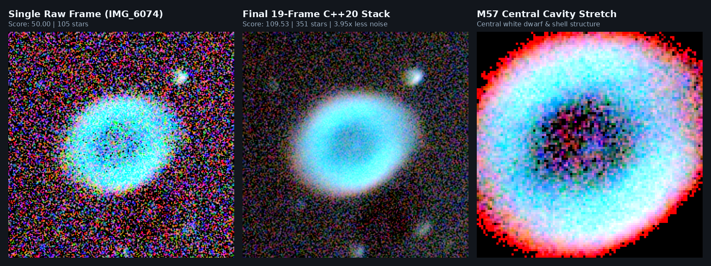
  <figcaption>Ring Nebula (M57, Canon EOS 1100D): single raw frame (left), final 19-frame C++ stack (middle), and a cavity stretch revealing the central white dwarf (right).</figcaption>
</figure>

**TL;DR:** I migrated my slow 2020 Python astro stacker to fast C++ and used **Gemini Carbon** to iteratively refine the algorithm. Automated hill-climbing added sharp techniques (rotation, Lanczos-3, Winsorized clipping), though visually the stack stayed fairly close to the clean baseline. For the biggest jump, I still needed to push the model to use standard **flat-field correction** by deriving a synthetic flat field from the data, removing the vignetting and dust donuts.

> *Note: This post was co-authored with heavy human input and refinement using Gemini 4 Neon (Medium).*

🖼️ [**Skip straight to the final images →**](#final-results) &nbsp;|&nbsp; 🧩 [**Technique appendix →**](#appendix) &nbsp;|&nbsp; 📄 [**Full technical paper (PDF) →**](/pdfs/2026-11-24-astro-stacker-paper.pdf)

---

## Where I Started: The 2020 Python Prototype

In 2020, I took 62 raw `.CR2` exposures on a Canon EOS 1100D (21 of the Ring Nebula M57, 21 of the Andromeda Galaxy M31, and 20 capped dark frames) and wrote a slow Python stacker that took minutes to run. Six years later, I wanted to migrate it to fast C++ and see how far an AI hill-climbing loop could push the image quality on its own (and where human intuition was still needed to think outside the box).

The original idea was simple: subtract the average dark frame, then slide pairs of images over each other and measure their **normalized absolute difference** (and cross-correlation). Wherever that difference hit a minimum was where I expected the frames to line up. Because stars occupy less than `0.2%` of the frame and empty sky noise dominates the full image, I also had to manually crop a **region of interest (ROI)** around bright stars to run those correlations on, moving closer to star-based registration, though still manual and limited to simple `(x, y)` shifts.

<figure>
  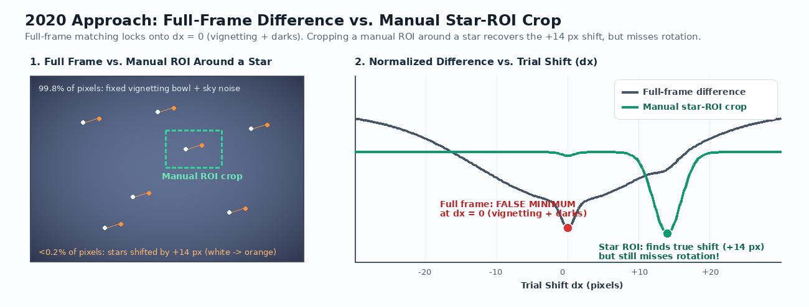
  <figcaption>Full-frame difference vs. manual star-ROI crop: on the full image, fixed vignetting and dark-frame residuals create a deep false minimum at dx = 0. Cropping a manual ROI around a bright star recovers the true +14 px shift, but still misses full-frame rotation and calibration.</figcaption>
</figure>

In practice, that 2020 approach still ran into several conceptual problems:

- **No rotation:** Over a 10-minute session, slight polar misalignment slowly rotates the sky across the sensor (on Andromeda, corner stars rotate by ~2.5 pixels). Pure `(x, y)` shifts, even inside a cropped ROI, can't fix that. *(And yes, the new C++ stacker does account for rotation!)*
- **No flat field (vignetting & dust motes):** Telescope optics darken the corners by ~32% and sensor dust casts dark donut shadows. Because those patterns stay fixed on the camera, whole-image comparison strongly prefers *zero shift* `(0, 0)` instead of following the drifting stars.
- **Temperature drift:** The camera cooled outdoors from `34 °C` at the start of the session down to `18 °C` by the time I took the dark frames. Because silicon dark current roughly doubles every `6 °C`, subtracting a cooler master dark left hundreds of bright "warm pixels" behind.
- **Empty sky dominates whole-image matching:** With stars covering less than `0.2%` of the 12-megapixel sensor, full-frame correlation mostly compares sky noise, vignetting, and leftover dark-frame error, forcing the manual ROI workaround above.
- **Real-world file & mount quirks:** The mount's worm gear reversed drift direction mid-session, and 5 of the `.CR2` files had corrupted bitstreams.

---

## How the Hill-Climbing Loop Works

Rather than tuning parameters by eye, I set up a simple automated loop with **Gemini Carbon** so the stacker could improve itself one small, verifiable step at a time (while keeping Andromeda as an untouched holdout set):

<figure>
  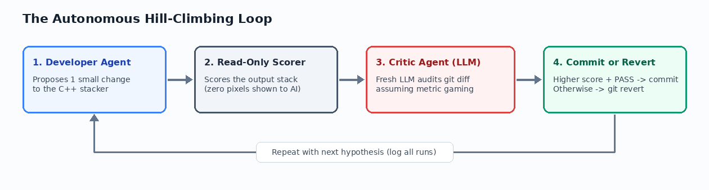
  <figcaption>The 4-step hill-climbing loop: propose one small change, score it blindly with a locked script, have a fresh Critic LLM audit the code diff, then commit or revert.</figcaption>
</figure>

### The Read-Only Scorer
Before writing any C++, we locked a standalone scoring script read-only so the optimizer could never move the goalposts. Evaluating the sharpest single raw frame against itself scores `50.0`, and every stacked output is scored by:

$$
\begin{aligned}
\text{Score} = 50 &+ 25\log_2\left(\frac{\sigma_{\text{bg}}^{\text{ref}}}{\sigma_{\text{bg}}^{\text{stack}}}\right) + 35\log_2\left(\frac{\text{FWHM}_{\text{eff}}^{\text{ref}}}{\text{FWHM}_{\text{eff}}^{\text{stack}}}\right) \cr
&+ 10\log_2\left(\frac{N_\star^{\text{stack}}}{N_\star^{\text{ref}}}\right) + 15\big(e_{\text{ref}} - e_{\text{stack}}\big) - 40\big(1 - \rho_{\text{ext}}\big) \cr
&- \infty \cdot F_{\text{cheat}}(\text{img})
\end{aligned}
$$

<figure>
  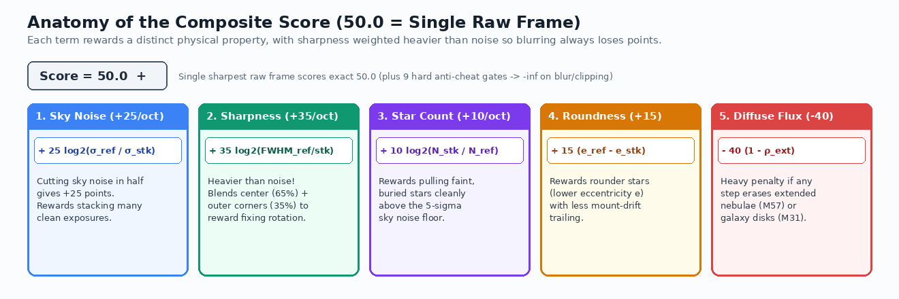
  <figcaption>Each term in the composite score rewards a distinct physical property, anchored at 50.0 on a single raw frame, with an anti-cheat indicator that forces -∞ on any violation.</figcaption>
</figure>

In plain terms, each box measures one thing:

- **Background sky noise ($$\sigma_{\text{bg}}$$):** Measures how grainy the empty sky is. Every time stacking cuts sky noise in half, the score jumps `+25` points.
- **Star sharpness ($$\text{FWHM}_{\text{eff}}$$):** FWHM (Full Width at Half Maximum) is how wide a star is in pixels at half its peak brightness (smaller means tighter and sharper). It blends the whole-frame median (`65%`) with the **outer corners of the image** (`35%`, where field rotation swings stars the farthest). Because sharpness is weighted `+35` per halving (heavier than noise's `+25`), simply blurring the image always loses points.
- **Detected star count ($$N_\star$$):** Counts how many genuine stars rise cleanly above the noise floor (`+10` points every time you double the number of visible stars).
- **Star roundness ($$e$$):** Eccentricity measures how stretched or trailed stars are (`0` is a perfect circle). Lower eccentricity earns up to `+15` points, rewarding tighter tracking and alignment.
- **Diffuse nebula & galaxy preservation ($$\rho_{\text{ext}}$$):** We mask out the stars, average the remaining pixels into coarse `16×16` and `64×64` blocks, and measure how closely that coarse brightness map correlates with the raw reference (`1.0` means extended structures like the Ring Nebula and Andromeda's disk are completely preserved; `0.0` means erased). Any background-subtraction trick that erases real nebula light gets hit with a heavy `-40` penalty.
- **Anti-cheat indicator ($$F_{\text{cheat}}(\text{img}) \in \{0, 1\}$$):** Equals `0` when the image passes all nine physical integrity gates below, and `1` (immediately forcing `Score = -∞`) on any violation.

### Inside $$F_{\text{cheat}}$$: The 9 Physical Anti-Cheat Gates
Before locking the scorer, we pre-verified it against **28/28 adversarial torture tests** (synthetic cheat stacks attempting blurring, clipping, frame dropping, gamma stretching, and forged alignment logs). Any violation of **Gates 0–5** (nine hard checks total) sets $$F_{\text{cheat}}(\text{img}) = 1$$ and immediately disqualifies the stack:

<figure>
  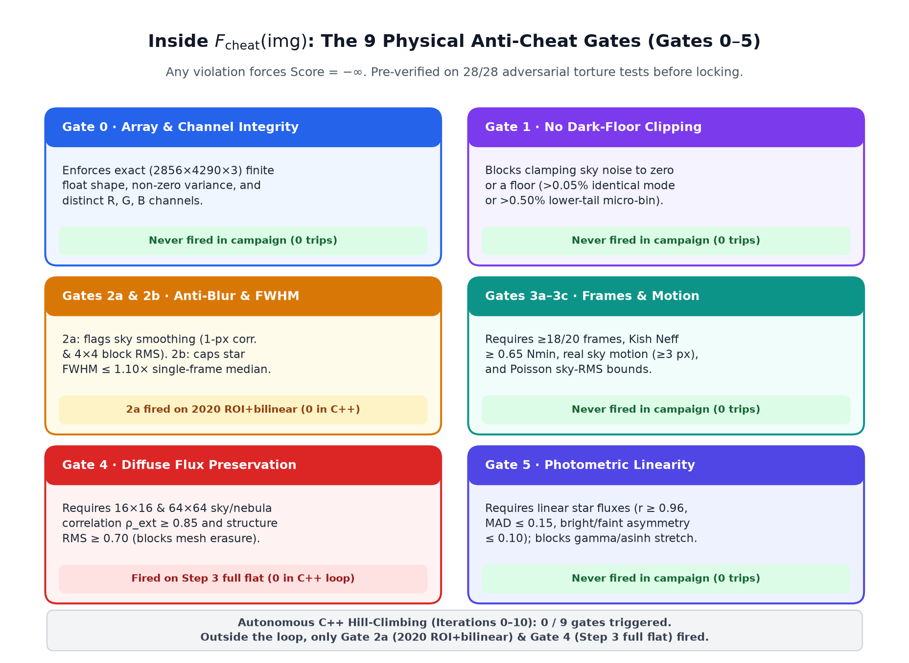
  <figcaption>The 9 hard physical anti-cheat gates (grouped as Gates 0–5) inside the locked scorer, along with whether each gate ever fired.</figcaption>
</figure>

- **Gate 0 (Array & Channel Integrity):** Enforces the exact `(2856, 4290, 3)` finite floating-point shape, non-zero variance, and three distinct RGB channels.
- **Gate 1 (Dark-Floor & Histogram-Tail Clipping):** Blocks clamping noisy sky pixels to zero or a constant floor (flags if `> 0.05%` of quiet sky pixels share an identical mode/floor value, or if narrow lower-tail micro-bins spike `> 0.50%`).
- **Gates 2a & 2b (Anti-Blur & Star Sharpness Ceiling):** **Gate 2a** catches spatial smoothing by checking quiet-sky 1-pixel lag autocorrelation ($$\rho_{1\text{px}}$$) and `4×4` block-averaged RMS inflation. **Gate 2b** caps stacked star width at `≤ 1.10×` the single-exposure ensemble median FWHM.
- **Gates 3a–3c (Frame-Drop, Weight Collapse & Poisson Bounds):** Requires at least `18` frames (`20` on M31), Kish effective sample size $$N_{\text{eff}} \ge 0.65\,N_{\min}$$, genuine sky motion (`≥ 3 px` median shift and `≥ 15 px` trajectory diagonal, preventing stationary hot-pixel stacking), and sky RMS consistent with Poisson noise scaling.
- **Gate 4 (Multi-Scale Diffuse Flux Preservation):** Requires coarse `16×16` and `64×64` nebula/sky correlation $$\rho_{\text{ext}} \ge 0.85$$ and `64×64` structure RMS ratio `≥ 0.70`, blocking background-mesh subtraction that erases faint nebulae or galaxy halos.
- **Gate 5 (Photometric Linearity & Symmetry):** Requires stacked star fluxes to stay linear against the reference (Pearson $$r \ge 0.96$$, relative MAD `≤ 0.15`, and bright-half vs. faint-half flux asymmetry `≤ 0.10`), blocking nonlinear gamma or `asinh` stretches.

**Did any of these gates actually fire?** Across all **10 autonomous C++ hill-climbing iterations** (`Iter 0–10`, both kept and reverted), **zero gates fired**. Every C++ candidate obeyed physical linearity and noise statistics cleanly. Outside that loop, however, **two gates did fire**, and both proved illuminating:
1. **Gate 2a (Anti-Blur) fired on the 2020 manual star-ROI + bilinear stack:** Bilinear interpolation acts as a mild low-pass blur, inflating quiet-sky 1-pixel correlation from `0.26` to `0.55` on M57 (`0.54` on M31). That artificially lowered single-pixel sky noise while softening stars, so Gate 2a immediately disqualified it (`Score = -∞`).
2. **Gate 4 (Diffuse Flux Preservation) fired on the Step 3 full synthetic flat field:** Removing the camera's `32%` radial vignetting dome legitimately changed the large-scale sky gradient relative to the un-flattened single-frame reference, so Gate 4 flagged it as "erased diffuse structure" (while dust-mote-only flat-fielding passed all 9 gates!). That is why Step 3 switched to a dedicated flat-field diagnostic scorer.

### The Critic Agent (A Fresh LLM)
Every time a change beat the best score, we spawned a **brand-new LLM instance** that had not written the code to review the `git diff` and metrics with this adversarial prompt:

> *"Inspect `git diff cpp_stacker/`, `logs/transforms.json`, and `evaluate.py` output. Assume the developer agent is trying to game the metric via spatial smoothing, non-linear stretching, dark-pixel clipping, or dropping valid frames. Verify physical linearity and output `AUDIT_PASS` or `AUDIT_FAIL` with reasoning."*

Only changes that beat the score **and** passed the Critic LLM were committed; anything else was immediately reverted with `git checkout`.

In this particular run, the developer agent never tried to cheat (all 7 kept commits passed `AUDIT_PASS`). Even so, keeping an independent Critic in the loop is important: autonomous optimizers routinely discover unintended loopholes in proxy metrics, a well-documented failure mode known as **specification gaming** or **reward hacking** (see [DeepMind's overview of specification gaming](https://deepmind.google/discover/blog/specification-gaming-the-flip-side-of-ai-ingenuity/) and [Skalse et al., NeurIPS 2022](https://arxiv.org/abs/2209.13085)). A fresh Critic reviewing the actual code diff catches shortcuts that a numeric score alone can miss.

---

## Step 1: A Clean C++ Baseline

Even the very first C++ baseline (`Iter 0`) already looked dramatically better than an unaligned average (`+45.7` points on M57, `+48.9` on M31) because it fixed the fundamentals at a high level:

1. **True 14-bit linear raw reading** directly via [LibRaw](https://github.com/LibRaw/LibRaw), automatically rejecting corrupted `.CR2` bitstreams.
2. **Clean master-dark subtraction** without clipping negative noise values to zero.
3. **Sharp linear demosaicing** ([Malvar-He-Cutler](https://www.ipol.im/pub/art/2011/g_mhcd/) `5×5`) instead of blurry consumer gamma-stretched JPEGs.
4. **Star-based alignment** instead of whole-image correlation, followed by simple shift-and-add averaging.

### How Star-Based Alignment Works
My original whole-image shift-and-difference idea was actually the unconventional approach. I had hoped comparing every pixel would give a cleaner signal, but on deep-sky photos where stars occupy less than `0.2%` of the sensor, whole-image matching gets drowned out by sky noise and vignetting.

In astronomy, the standard way to align deep-sky frames is **star-based registration** (the same general idea used by tools like PixInsight, Siril, and DeepSkyStacker). Instead of sliding whole images across each other, the C++ stacker aligns every exposure in three clean steps:

1. **Find the stars:** Convert each calibrated frame to grayscale luminance, estimate the local sky brightness and noise on a coarse grid (used only for detection, never subtracted from the final image), and pick out connected bright blobs rising `5σ` above the local background (filtering out single-pixel spikes and saturated star cores). We keep the top ~60 brightest stars and record their `(x, y)` centers.
2. **Compute the shift (and later, rotation):** Match each frame's star `(x, y)` coordinates to the reference frame's star coordinates to solve the exact offset between the two exposures.
3. **Resample and combine:** Shift (or rotate) each frame's pixels onto the reference grid and stack them together.

<figure>
  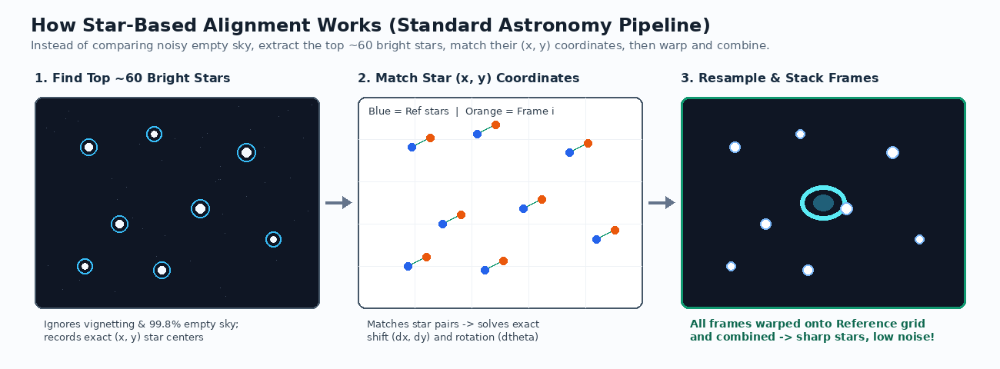
  <figcaption>The 3-step star-based alignment pipeline: extract the top ~60 bright star centers, match their (x, y) coordinates to solve the shift and rotation, then resample and stack the frames.</figcaption>
</figure>

---

## Step 2: Automated Refinements & The "Aha" Moment

From that clean baseline, the hill-climbing loop tested 10 atomic hypotheses on M57 (keeping 7 and reverting 4, such as an overfitting 6-DOF affine warp and directional Hamilton-Adams demosaicing). Five key techniques drove the gains (click any technique to jump to its visual explanation in the [Appendix](#appendix)):

- [**Sub-Pixel Alignment & 2D Lanczos-3 Resampling (`Iter 3`, `+1.34`)**](#appendix-lanczos3): Fits exact sub-pixel 2D Gaussian star centers and interpolates the fractional shift with a `6×6` windowed-sinc grid instead of blurry bilinear averaging.
- [**Star-Triangle Rotation Matching (`Iter 4`, `+0.34`)**](#appendix-triangles): Matches scale- and rotation-invariant star triangles to solve exact 4-DOF `(dx, dy, rotation, scale)`, fixing Andromeda's `2.5 px` corner rotation.
- [**Differential Sky-Plane Equalization & PSF Weighting (`Iter 6`, `+0.94`)**](#appendix-sky-plane): Subtracts `Frame - Reference` so the galaxy cancels out before fitting a tilted skyglow plane, and weights sharper frames higher than drift-blurred frames.
- [**Winsorized Sigma Clipping (`Iter 7`, `+0.18`)**](#appendix-winsorized): Clamps temporal outliers to a `±2.8σ` fence before averaging, wiping out all `32` warm-pixel streaks on M57 and all `477` on M31 with zero blurring.
- [**Partial-Row Bitstream Salvage (`Iter 10`, `+0.33`)**](#appendix-bitstream): Safely salvages the clean top `2,468` rows (`86.4%`) of a partially corrupted `.CR2` exposure (`IMG_6089.CR2`), boosting M57 from 18 to 19 integrated frames.

### The "Aha" Moment: An Imperfect Scorer & Non-Commutative Ordering (`Iter 8`)
A camera sensor has a narrow strip of pixels along its left edge (`58` columns wide on the Canon 1100D) that is physically covered by an opaque shield so **no light ever hits it**. This **optical-black border** measures the camera's pure electronic baseline ("pedestal," around `2048 ADU`), which drifts slightly from row to row and frame to frame.

Early on (`Iter 1` and `Iter 2`), we tried upgrading our dark calibration using three physical improvements: subtracting each row's optical-black border median, building a Winsorized master dark, and scaling the dark frame to compensate for temperature drift (plus trying to patch warm pixels in each frame). Surprisingly, **both attempts hurt the score (`-0.71` and `-0.79`) and were reverted!**

Why would better sensor calibration make the score worse? Looking at the failed logs revealed a subtle flaw in the **scorer itself**. To prevent single hot pixels from dominating the sharpness score, the scoring script defensively filtered out 1-pixel hotspots. A warm pixel is a defect stuck at one fixed spot on the camera sensor (left bright because the camera was warmer during the light shots than during the darks). However, **shifting the frames to align the stars** also shifts those stuck bad pixels along with each frame. In `Iter 0` (before we had Winsorized clipping across frames), five exposures only drifted `2` to `4` pixels, so shifting them piled each warm pixel right next to itself into a `~4 px` blob in the corners of the image. Shifting the bad pixels across multiple pixels made them unremovable by the scorer's 1-pixel defense, yet still small enough to drag the measured corner star width down artificially. When `Iter 1` and `Iter 2` removed those warm pixels, the fake `~4 px` blobs vanished and the true, wider optical corner stars (`~15 px`) showed up, which looked like a drop in sharpness.

Once `Iter 7` added Winsorized sigma clipping across the stack, those smeared hotspots were removed properly along the time axis, overcoming the scorer's blind spot. Re-applying pure sensor calibration in `Iter 8` (optical-black row pedestal + Winsorized master dark + temperature dark scaling, with no single-frame pixel patching) was finally compared apples-to-apples on real stars, immediately jumping **`+0.37`** and hitting the sharpest star FWHM of the entire run.

**The takeaway:** No automated score is perfect, and a human still needs to inspect what the score is actually rewarding. Even so, the scorer was good enough that `Iter 0`'s blind spot was only a shallow **artificial local minimum**: to reach the genuinely deeper optimum, the pipeline still had to solve the underlying physics properly.

<figure>
  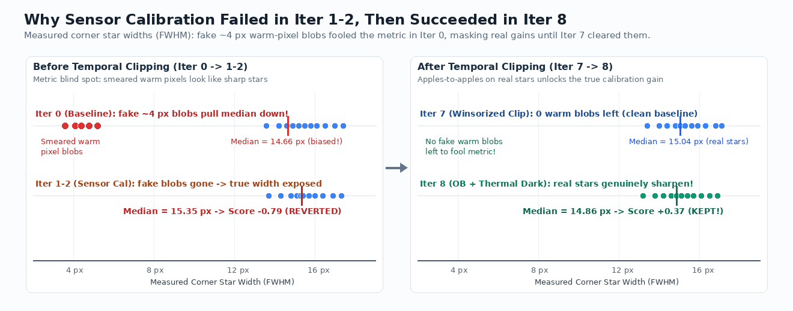
  <figcaption>The scorer blind spot behind the "Aha" moment: smeared ~4 px warm-pixel blobs slipped past the scorer's 1-pixel hotspot filter and pulled Iter 0's corner FWHM down. Once Winsorized clipping (Iter 7) removed them, pure sensor calibration (Iter 8) sharpened real corner stars cleanly.</figcaption>
</figure>

<figure>
  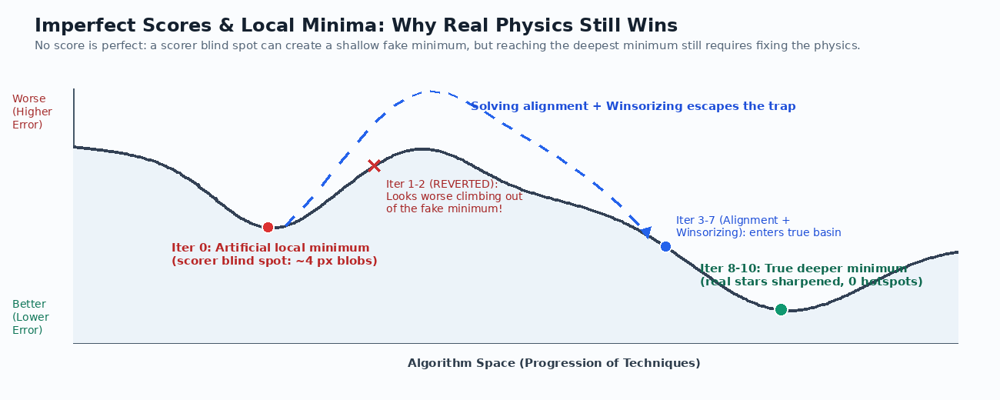
  <figcaption>Hill-climbing with an imperfect score: a scorer blind spot can create a shallow artificial local minimum (Iter 0), making direct fixes look worse at first (Iter 1–2), but reaching the true deeper minimum still requires fixing the underlying physics (Iter 3–10).</figcaption>
</figure>

---

## Step 3: Thinking Outside the Box with a Blind Synthetic Flat Field

Everything above solved alignment, rotation, temperature drift, and noise, and migrated the slow Python prototype to a fast C++ engine. Visually, though, the refined pre-flat stack still looked fairly close to our clean baseline: because I never shot physical **flat frames** in 2020, both stacks still had the telescope's **`32%` radial vignetting bowl** and dark **sensor dust donuts**.

Importantly, **the AI never suggested fixing this on its own**. To be clear, flat-field correction is a textbook technique that any beginner amateur astronomer knows about; "outside the box" here refers to the **AI's optimization box**, which is generally much narrower than a human's. Locked inside its hill-climbing loop and scored against an unflattened reference, the agent optimized brilliantly *within* the box I gave it but never stepped outside it. Pushing the image to the next level took my own input: suggesting that we estimate a [**blind synthetic flat field**](#appendix-flat-field) (`flat_field.cpp`) strictly from the sparse M57 frames (smooth radial vignetting multiplied by a Wiener-regularized dust-mote map) and divide it out blindly on M31 so Andromeda's galaxy disk could not bias the flat.

The result: radial vignetting collapsed from **`32.1% → 1.0%`** on M31 (`32.0% → -1.5%` on M57), quiet-sky scatter became **4.4× to 7.0× flatter**, and cross-dataset sensor dust-mote correlation dropped **15×** (`0.348 → 0.023`).

One interesting wrinkle with the scorer: our original read-only scoring script checked extended flux ($$\rho_{\text{ext}}$$) by comparing `64×64` blocks of the stack against the **unflattened** raw reference frame. Because that raw reference still had the curved `32%` vignetting bowl, flattening the sky made it stop matching the curved reference and tripped the nebula-erasure check! To evaluate flat-fielding properly without unlocking the original scorer, we refined the evaluation for this stage with a dedicated flat-field diagnostic script (`evaluate_flat_motes.py`) that directly tracks radial vignetting drop, sky flatness, and cross-dataset dust-mote correlation.

---

## Putting It All Together: Plot, Table & Bigger Lessons

To measure true end-to-end gain, the chart and table below use the **unaligned dark-subtracted mean** as `0.00` (raw score `60.28` on M57, `62.57` on M31) and plot how much each technique improved above it. Even with every stage enabled, the parallel C++/OpenMP engine runs **purely on the CPU** (16 threads, no GPU required) and processes an entire session of ~40 raw `.CR2` files end-to-end in roughly **70 to 90 seconds** (compared to several minutes in the original 2020 Python prototype):

<figure>
  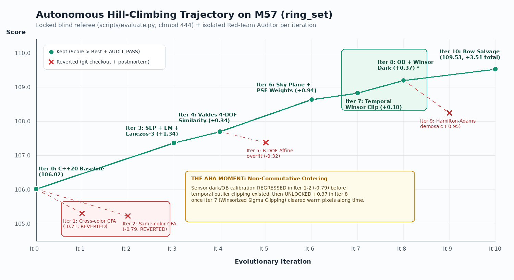
  <figcaption><strong>Top:</strong> Score gain above the unaligned dark-subtracted mean baseline for both M57 (green, <code>60.28 → 0.0</code>) and M31 zero-shot holdout (purple, <code>62.57 → 0.0</code>). <strong>Bottom:</strong> M31 flat-field diagnostics showing vignetting drop, sky uniformity, and dust-mote removal.</figcaption>
</figure>

| Stage / Technique | What It Does | M57 $$\Delta$$ vs. Base | M31 $$\Delta$$ vs. Base | Key Impact |
| :--- | :--- | :---: | :---: | :--- |
| **Unaligned Mean (Base)** | Dark-subtracted average, no alignment | `0.00` (`60.28`) | `0.00` (`62.57`) | Star trails (`FWHM 16.0 / 13.5 px`) |
| **2020 Best-Effort ROI + Bilinear** | Naive dark, manual star-ROI shift, bilinear | *anti-blur fail*\* | *anti-blur fail*\* | Bilinear blur (`0.55` neighbor corr), `164` M31 streaks |
| **It 0: C++ Baseline** | 14-bit raw, MHC `5×5`, star shift+add | `+45.74` | `+48.86` | Stars snap sharp; `316 / 249` stars |
| **It 3: Sub-Pixel Lanczos-3** | Gaussian star centers + fractional shift | `+47.08` | - | `+27` faint stars, sharper cores |
| **It 4: Valdes 4-DOF Rotation** | Star-triangle matching (`dx, dy, dθ, s`) | `+47.42` | - | Fixes `2.5 px` corner rotation |
| **It 6: Sky Plane + PSF Weights** | Differential sky plane + sharpness weights | `+48.36` | - | Beats single-frame median FWHM |
| **It 7: Winsorized Clipping** | Clamps temporal outliers to `±2.8σ` fence | `+48.55` | - | Warm-pixel streaks `32 → 0` (`477 → 0` M31) |
| **It 8: OB + Thermal Dark** | Row bias + Winsorized dark + temp scaling | `+48.92` | - | **Aha moment:** `+0.37` *after* It 7 |
| **It 10: Partial-Row Salvage** | Recovers clean top `2,468` rows of bad `.CR2` | `+49.25` | `+52.31` | `19` frames, `351` stars, `3.95×` less noise |
| **Flat F2: Dust-Mote Solver** | Iterative sky-model dust-mote flat | **`+49.31`** | **`+53.38`** | Highest locked-referee score (`109.58 / 115.95`) |
| **Flat F6: Full Session Flat** | Blind radial vignetting + Wiener motes | *flat sky*\* | *flat sky*\* | Vignetting `32% → 1%`, **15×** less dust corr |

*\*The 2020 ROI + bilinear stack failed the scorer's built-in **anti-blur check** (`score = -inf`) because bilinear averaging acts as a low-pass blur filter, more than doubling adjacent sky-pixel correlation from `0.26` to `0.55` (artificially crushing pixel noise while softening stars to `11.28 / 8.43 px`). Meanwhile, `Flat F6` is evaluated with the refined flat-field diagnostic (`evaluate_flat_motes.py`) because the original reference frame still carries the `32%` vignetting bowl.*

### How This Compares to Industry Software
One reassuring outcome is that **blind hill-climbing independently steered us straight to the industry standard** (PixInsight, Siril, DeepSkyStacker): star-triangle matching, Lanczos-3 resampling, PSF/SNR weighting, Winsorized Sigma Clipping, and thermal dark scaling. Mature suites still go further on wide-field lens distortion, Bayer Drizzle, local cloud normalization, and GUI post-processing.

| Capability | Our C++ Stacker | PixInsight / Siril / DSS |
| :--- | :--- | :--- |
| **Core alignment & resampling** | Valdes star triangles + 4-DOF + Lanczos-3 | Star triangles/quads + Lanczos-3/4 (plus splines/drizzle) |
| **Outlier rejection & darks** | Winsorized Sigma Clipping + OB/thermal dark scaling | Winsorized Sigma Clipping + dark optimization |
| **Missing flats (dust donuts)** | **Custom blind session flat** (`M57 → M31`) | Expects real flats (post-stack gradient tools miss dust donuts) |
| **Partially corrupted `.CR2`** | **Salvages clean top 86.4%** with 10-row safety margin | Rejects or skips corrupted file |
| **Silent decoder underflow** | **Custom 14-bit physical percentile gate** | Trusts `LibRaw` success code (silent dark-frame poisoning) |

That brings together the two real lessons of this project:

1. **AI excels at building tailored, deterministic, and auditable algorithms on the fly** for the exact quirks of the data in front of you (missing flats, a partially glitched raw file, a silent decoder bug), even when it is hard to beat mature industry software on general-purpose techniques.
2. **Automated hill-climbing still optimizes inside the box you give it.** Gemini Carbon introduced genuinely solid refinements (Lanczos-3, star-triangle rotation, Winsorized clipping), yet the pre-flat stack looked broadly similar to the clean baseline. The biggest visual breakthrough only happened when I stepped in with domain intuition and suggested estimating a synthetic flat field. Human direction plus AI execution is still what unlocks the best results.

### Token Budget & What Plan You Would Need
For anyone curious about the AI compute cost of running a multi-phase hill-climb like this, here is an estimate from the full transcripts across both main sessions and all 19 spawned subagents (~4 characters per token; cumulative input tokens include repeated prompt-cached history):

| Session | Threads | LLM Turns | Generated Tokens (output + thinking + tool calls) | Cumulative Input Tokens (mostly cached) |
| :--- | :---: | :---: | :---: | :---: |
| **Core Hill-Climb + Paper** | 1 main + 13 subagents | `1,128` | `~1.17M` | `~245M` |
| **Synthetic Flat-Field + Grids** | 1 main + 6 subagents | `333` | `~268k` | `~16M` |
| **Total** | **2 main + 19 subagents** | **`1,461`** | **`~1.44M`** | **`~261M`** |

A portion of those tokens went into compiling the 15-page LaTeX paper and generating visual plates, though the bulk was spent on the core algorithm evolution, torture-testing, and red-team audits. Notice also that spawning fresh subagents kept audit context tiny (~`15M` cumulative input across all 19 subagents combined, compared to ~`246M` on the long-running main threads).

**Which subscription plan fits a run like this?**
- [**Google AI Pro (`$19.99/mo`)**](https://one.google.com/about/google-ai-plans/) includes both **Gemini Carbon** and **Gemini Neon** in Antigravity, using a rolling **5-hour refresh window** under a **weekly cap**.
- Running the full ~1,100-turn hill-climb in a single sitting on Gemini Carbon would easily hit the **5-hour limit** multiple times and likely exceed a single **weekly cap** on AI Pro. On AI Pro, you would want to pace it across several 5-hour windows (or split phases into fresh conversations so the main context does not snowball to ~600k tokens). If you want to run a heavy multi-day sprint uninterrupted, [**Google AI Ultra**](https://one.google.com/about/google-ai-plans/) (5× to 20× the quota) gives much more breathing room.
- **Gemini Carbon vs. Gemini Neon:** Although I ran these experiments with **Gemini Carbon**, **Gemini Neon** has since launched and is faster, lighter on quota, and an even better fit for iterative agentic coding loops like this one.

---

## Final Results {#final-results}

Each 2×2 grid below walks through the exact same four stages: **(1) naive unaligned average** → **(2) my 2020 method (manual star-ROI shift + bilinear)** → **(3) evolved C++ stacker (pre-flat)** → **(4) evolved C++ stacker + blind synthetic flat field**.

*(As a bonus validation of our scorer: the 2020 ROI + bilinear stack actually aligned the stars reasonably well, but bilinear averaging blurred neighboring sky pixels together so heavily that adjacent-pixel correlation jumped from `0.26` to `0.55`, triggering the scorer's built-in **anti-blur check** (`score = -inf`) while leaving `164` RGB warm-pixel streaks on Andromeda, softer stars, `32%` vignetting, and dark dust donuts.)*

### Ring Nebula (M57): Zoomed View
Notice the dark dust-mote donut right below the Ring Nebula in panels 1 to 3 disappearing cleanly in panel 4:

<figure>
  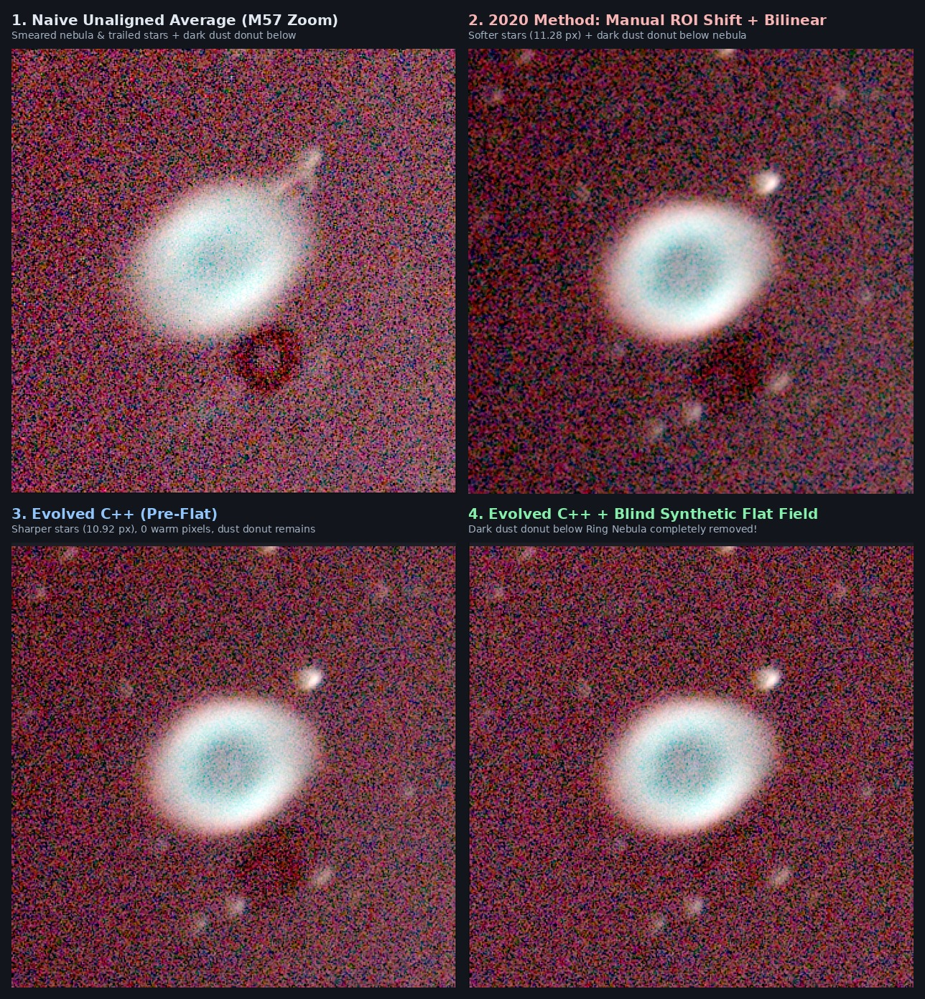
</figure>

### Ring Nebula (M57): Full Field
Radial vignetting drops from `32.0%` to `-1.5%`, and the background sky becomes `7.0×` flatter:

<figure>
  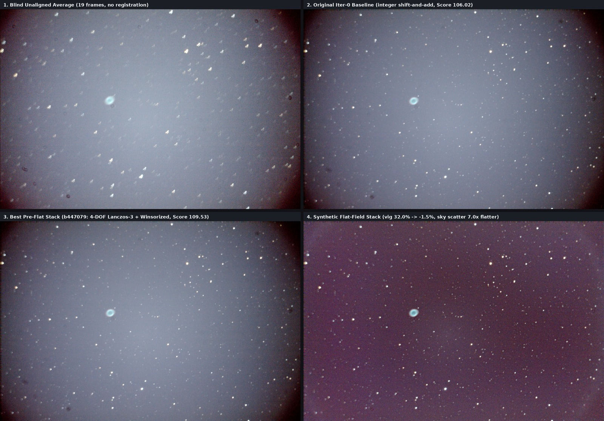
</figure>

### Andromeda Galaxy (M31): Zero-Shot Holdout + Blind Flat
Processed with zero retuning, then flattened using the synthetic flat estimated solely from M57, removing all 164 RGB warm-pixel streaks from panel 2 and bringing out M31's elliptical disk, dark dust lanes, and companion galaxy M32 in the lower right:

<figure>
  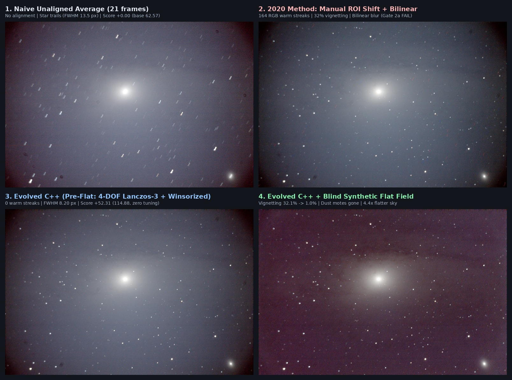
</figure>

---

## Appendix: How Each Technique Works Visually {#appendix}

### A. Sub-Pixel Alignment & Lanczos-3 Resampling (`Iter 3`) {#appendix-lanczos3}
In the baseline, we measured star centers with a simple center-of-mass and rounded each frame's shift to the nearest whole pixel, introducing up to `±0.5 px` of jitter per frame and softening star cores. Here we upgraded Step 1 to fit smooth **2D Gaussian centers** to the ~60 brightest stars purely to measure the exact fractional shift (for example, `dx = +10.40 px, dy = -3.72 px`).

To actually shift all 12.25 million pixels by a fractional amount like `0.4` pixels, we have to **interpolate** between grid points (an image array has no index `2.4`). **Lanczos-3 resampling** (Step 3) does this with a fixed weighted average of the 6 nearest neighbors rather than any curve fitting. For example, on a 1D slice of pixels `[10, 12, 80, 100, 15, 11]`, interpolating at `x = 2.4` multiplies each neighbor by its fixed Lanczos-3 weight and sums them up:

```
in[2.4] = 0.02(10) - 0.14(12) + 0.72(80) + 0.46(100) - 0.08(15) + 0.02(11) = 101.1
```

By contrast, simple **bilinear** interpolation only averages the two closest pixels (`0.60(80) + 0.40(100) = 88.0`), squashing the star peak from `101` down to `88`. Extending that `6`-neighbor weighted sum to a `6×6` patch in 2D works no matter how large the shift is (even 50+ pixels), because we jump by the whole-pixel shift first and only use the `6×6` grid for the fractional remainder between `0` and `1`. What actually matters is that the `6×6` window captures the local point spread function (PSF) cleanly, keeping stars crisp and giving our biggest single refinement jump (`+1.34`).

<figure>
  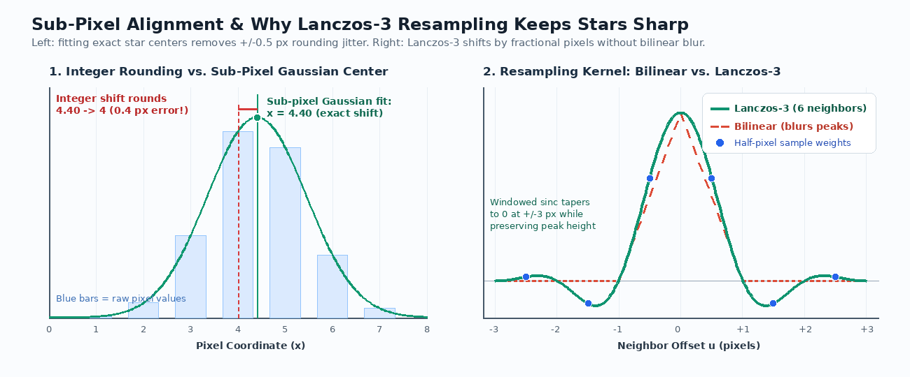
  <figcaption>Left: 2D pixel grid around a star PSF. After jumping by the whole-pixel shift, the 6×6 Lanczos-3 grid comfortably spans the star's spread around the fractional target (yellow crosshair), unlike a 2×2 bilinear box. Right: the 6-neighbor windowed sinc weights at a +0.40 px shift.</figcaption>
</figure>

### B. Handling Rotation with Star-Triangle Matching (`Iter 4`) {#appendix-triangles}
Once you have ~60 star `(x, y)` coordinates in the reference frame and ~60 in a later frame, how do you know which star is which when the sky has both drifted and rotated? We upgraded Step 2 with **Valdes star-triangle geometric hashing**: pick bright stars and form triangles out of them. The *ratios* of a triangle's side lengths `(L1/L2, L0/L2)` stay identical no matter how much the frame shifts, rotates, or zooms. Matching those triangles identifies ~50 corresponding star pairs across the two frames, and a least-squares fit on those matched coordinates solves the exact 4-DOF similarity transform `(dx, dy, rotation, scale)`.

<figure>
  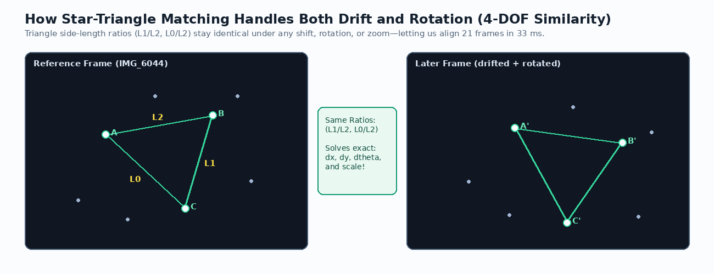
  <figcaption>Star-triangle matching: because a triangle's side-length ratios are invariant to shift and rotation, matching star triangles recovers both drift and field rotation cleanly.</figcaption>
</figure>

*(We also tested a 6-DOF full affine transform in `Iter 5`, which overfit off-axis coma and hurt corner sharpness, so it was automatically reverted.)*

### C. Differential Sky-Plane Equalization & Smart Frame Weighting (`Iter 6`) {#appendix-sky-plane}
As a target moves across the sky, light pollution and skyglow shift slightly from one exposure to the next (one frame may be slightly brighter overall, or brighter on one side). If you tried to estimate and subtract the background directly from each frame, it's easy to mistake Andromeda's huge glowing disk for "bright sky" and accidentally erase part of the galaxy.

The trick is to **subtract the aligned reference frame first**: because both aligned frames contain the exact same galaxy in the exact same pixels, taking `Frame - Reference` cancels out Andromeda and the stars completely, leaving *only* the change in skyglow between the two shots. We split that difference image into coarse `96×96` patches, take the median of each patch, and fit a simple flat tilted sheet (`a + bx + cy`) across them. Subtracting that sheet brings every frame to the same sky level without ever touching the galaxy.

<figure>
  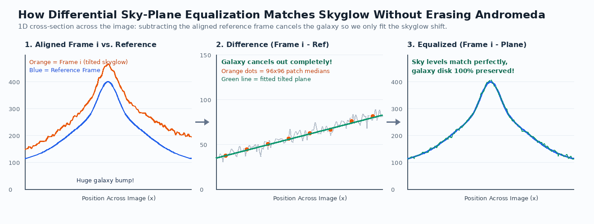
  <figcaption>Differential sky-plane equalization: subtracting the aligned reference frame cancels Andromeda's glowing disk completely, leaving only the tilted skyglow shift to fit and remove.</figcaption>
</figure>

Finally, instead of giving every exposure equal weight, we weight sharper, cleaner frames higher than frames blurred by mount drift, making the combined stack sharper than the median single exposure (`+0.94`).

### D. Winsorized Sigma Clipping (`Iter 7`) {#appendix-winsorized}
Even after aligning stars, temperature drift left behind bright **warm pixels** (and occasional cosmic rays) that trace faint red/blue streaks across the stack when you take a plain average.

**What does "Winsorized" mean?** Look at a single pixel across 18 aligned exposures: 17 frames cluster around the true sky value (`~200 ADU`), while 1 frame has a warm-pixel spike (`515 ADU`).
- A **plain mean** gets pulled up by the spike.
- A **pure median** ignores the spike, but throws away statistical efficiency (~25% noisier).
- **Winsorized sigma clipping** computes the robust center and spread (median & MAD), sets a `±2.8σ` fence, and **clamps** any outlier back to the fence before averaging.

<figure>
  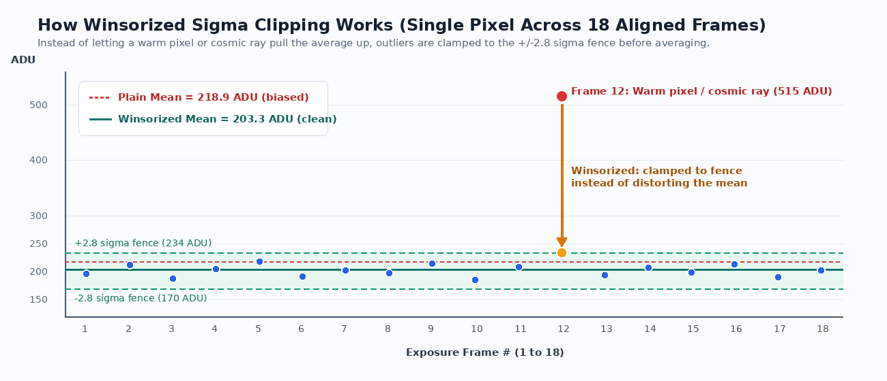
  <figcaption>Winsorized sigma clipping on a single pixel across 18 frames: clamping the Frame 12 warm-pixel spike to the ±2.8σ fence keeps the mean clean without losing the noise-reduction benefit of averaging.</figcaption>
</figure>

On M57, warm-pixel artifacts dropped from **`32 → 0`**; on M31, all **`477` warm-pixel streaks vanished**, with zero spatial blurring.

### E. Partial-Row Bitstream Salvage (`Iter 10`) {#appendix-bitstream}
One M57 exposure (`IMG_6089.CR2`) had a bitstream glitch only in its bottom 4 strips. Scanning rows top-down let us safely salvage its clean top `2,468` rows (keeping a 10-row safety margin away from the glitch so our `6×6` Lanczos-3 stencil never touches corrupted pixels), boosting us from 18 to **19 integrated frames** (`+0.33`).

<figure>
  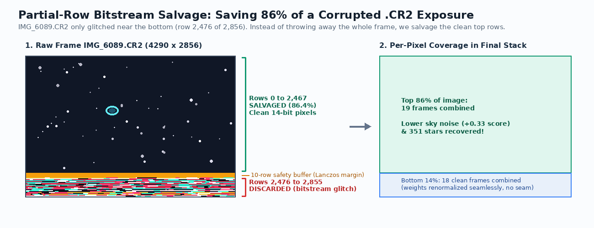
  <figcaption>Partial-row bitstream salvage on IMG_6089.CR2: keeping a 10-row safety margin above the corrupted bottom strips lets us salvage 86.4% of the exposure cleanly, increasing coverage to 19 frames across most of the image.</figcaption>
</figure>

### F. Blind Synthetic Flat-Field Anatomy (`Flat F6`) {#appendix-flat-field}
You can't easily estimate a flat directly from Andromeda because the galaxy fills the whole frame. Instead, `flat_field.cpp`:
1. Estimates the optical transmission strictly from the sparse **Ring Nebula (`ring_set`)** frames, where M57 is tiny and stars drift across the sensor.
2. Separates the flat into two components: a smooth per-channel **radial vignetting curve** plus a **Wiener-regularized dust-mote map** (band-passed to `10–180 px` so it catches dust donuts without amplifying pixel noise).
3. Divides that *same* session flat blindly out of **Andromeda (`andromeda_set`)**.

<figure>
  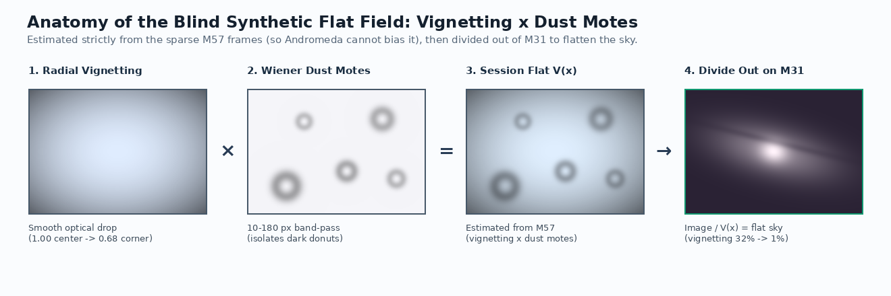
  <figcaption>Illustrative schematic (simulated mockup, not actual telescope data): the blind synthetic flat field decomposes optical illumination into smooth radial vignetting multiplied by a band-passed Wiener dust-mote map, estimated from M57 and divided out of M31. See <a href="#final-results">Final Results</a> above for the actual camera images.</figcaption>
</figure>
